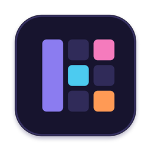
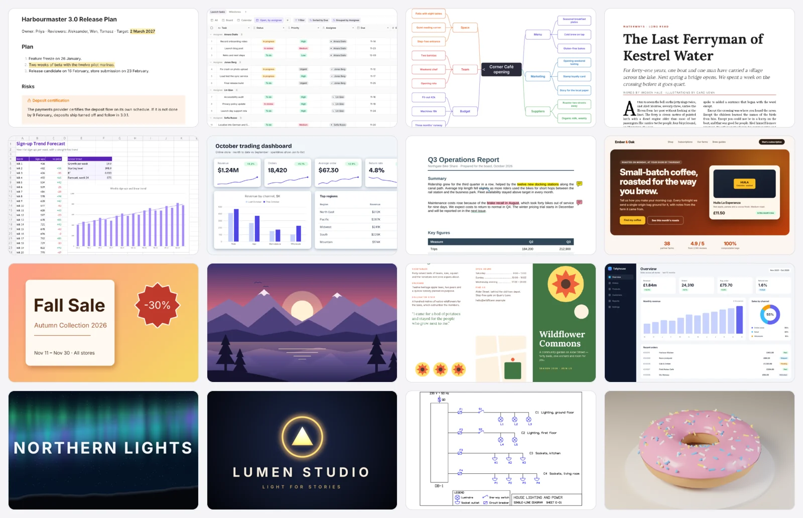

<h1 align="center">
   Kition
</h1>

  <strong>English</strong> ·
  <a href="docs/readme/README.zh-CN.md">简体中文</a> ·
  <a href="docs/readme/README.ru-RU.md">Русский</a> ·
  <a href="docs/readme/README.ja-JP.md">日本語</a> ·
  <a href="docs/readme/README.vi-VN.md">Tiếng Việt</a> ·
  <a href="docs/readme/README.fr-FR.md">Français</a> ·
  <a href="docs/readme/README.de-DE.md">Deutsch</a> ·
  <a href="docs/readme/README.es-ES.md">Español</a>

  <strong>Kition: the open pro suite for AI.</strong> 
  Notes, tables, boards and professional editors in one desktop workspace, edited by you and your agent.

  
  
  
  
  
  
  

  <a href="https://kition.ai">Website</a> ·
  <a href="https://developer.kition.ai">Developers</a> ·
  <a href="https://discord.gg/bFSjRDjVY">Discord</a> ·
  <a href="https://www.reddit.com/r/Kition">Reddit</a> ·
  <a href="https://x.com/KitionAI">X</a> ·
  <a href=".github/CONTRIBUTING.md">Contributing</a> ·
  <a href=".github/SECURITY.md">Security</a>

  

Sixteen files, one per kit, each made with the kit's own commands and drawn by its own engine. More in <a href="https://github.com/KitionAI/kition-showcase">Kition Showcase</a>.

Kition is a desktop workspace where every file opens in a real editor, and an AI agent works on
the same files with the same commands you use. A video timeline, a motion graphic, a layered
image, a slide deck, a spreadsheet, a Word document, a PDF, a note or a whiteboard: each is an
ordinary file in your workspace folder, opened by a **kit**, the editor for that kind of file.

The agent does not paste text back at you. It reads the file through the kit, changes it with the
kit's commands, previews the result, and runs the kit's checks. You see every change, and you can
let it work in a draft that you review before anything changes.

> Kition 0.1.0 is in beta. Keep backups of important workspaces.

## What you can do

- **Open sixteen kinds of files.** Videos, motion graphics, photos, vector art, page layouts,
  interface designs, documents, spreadsheets, slides, PDFs, web pages, notes, tables, boards, CAD
  drawings and 3D scenes. See [Kits](#kits).
- **Hand work to the agent.** It edits the open file through the kit's object model, exports it to
  another file, and previews a page, a frame or a region with the kit's own renderer.
- **Review before you keep.** The agent can work in a draft; a write that rests on something you
  have changed since is refused instead of written over your work.
- **Start from working examples.** The Getting Started workspace has tables whose AI fields and
  scenarios extract, generate and summarize from each row.
- **Script your workspace.** A workspace script edits the open document through the kit's object
  model.

## Kits

A kit is the editor for one kind of file. Its engine is written in Rust, compiled to WebAssembly
and run in a Web Worker; the kit draws its own editor inside Kition. The agent drives the same
engine through the kit's tools, over the [Kit Harness Protocol](https://github.com/kitharness/khp).
Every kit is open source in its own repository, and the packages Kition ships are pinned in
[`kits/kits.lock.json`](kits/kits.lock.json).

| Product line | Kit | Edits | Opens | Creates |
| --- | --- | --- | --- | --- |
| Media | [Film](https://github.com/KitionAI/kition-film) | Video timelines | `.kfilm` | `.kfilm` |
| Media | [Motion](https://github.com/KitionAI/kition-motion) | Motion graphics with keyframes and effects | `.kmotion` | `.kmotion` |
| Office | [Note](https://github.com/KitionAI/kition-note) | Markdown notes, saved byte for byte | `.md` `.markdown` | `.md` |
| Office | [Table](https://github.com/KitionAI/kition-table) | Tables, views and dashboards in one file | `.ktable` | `.ktable` |
| Office | [Board](https://github.com/KitionAI/kition-board) | An infinite whiteboard for diagrams, mind maps and sketches | `.kboard` | `.kboard` |
| Office | [Doc](https://github.com/KitionAI/kition-doc) | Word-processing documents | `.docx` `.html` `.htm` | `.docx` |
| Office | [Sheet](https://github.com/KitionAI/kition-sheet) | Spreadsheets with formulas | `.xlsx` `.xlsm` `.xltx` `.xltm` `.xls` `.xlt` `.et` `.ett` `.xlsb` `.ods` `.csv` | `.xlsx` |
| Office | [Slide](https://github.com/KitionAI/kition-slide) | Slides, including `.pptx` files | `.kslide` `.pptx` | `.kslide` |
| Office | [PDF](https://github.com/KitionAI/kition-pdf) | Read and edit PDF files | `.pdf` | `.pdf` |
| Office | [HTML](https://github.com/KitionAI/kition-html) (Preview) | HTML pages, with a live preview | `.html` `.htm` | `.html` |
| Design | [Photo](https://github.com/KitionAI/kition-photo) | Layered images, including `.psd` files | `.psd` `.psb` `.kphoto` | `.psd` |
| Design | [Vector](https://github.com/KitionAI/kition-vector) | Vector graphics | `.kvector` `.svg` `.ai` `.eps` | `.kvector` |
| Design | [Layout](https://github.com/KitionAI/kition-layout) | Page layouts: flyers, posters and books | `.klayout` `.idml` | `.klayout` |
| Design | [Design](https://github.com/KitionAI/kition-design) (Preview) | Interface and screen designs | `.kdesign` `.fig` `.sketch` | `.kdesign` |
| Engineering | [CAD](https://github.com/KitionAI/kition-cad) | 2D CAD drawings | `.dxf` | `.dxf` |
| Engineering | [Scene](https://github.com/KitionAI/kition-scene) (Preview) | 3D scenes | `.kscene` | `.kscene` |

Kits marked Preview are early: expect gaps. To embed a kit in your own app or give it to your own
agent, see the [Kition SDK](https://github.com/KitionAI/kition-sdk) and
[developer.kition.ai](https://developer.kition.ai).

## Install

Desktop builds of Kition 0.1.0 for macOS, Windows and Linux will be published on
[GitHub Releases](https://github.com/KitionAI/kition/releases). Until then, Kition runs from
source: see [CONTRIBUTING.md](.github/CONTRIBUTING.md#run-from-source).

## What is in this repository

Everything that makes up the Kition desktop app:

- the React renderer (`src/`): the workspace, the kit host, the agent, settings and scenarios;
- the Tauri desktop shell (`src-tauri/`);
- the Rust runtime (`crates/`), which the shell runs in-process and which serves its HTTP API on
  loopback only ([runtime development](docs/runtime-development.md));
- the runtime contracts (`contracts/runtime/`), mocks, fixtures and tests;
- the kit pins (`kits/`) and the packaging and release workflows.

## Contributing

Issues and pull requests are welcome. How to run Kition from source, the repository layout and the
technology it uses are in [CONTRIBUTING.md](.github/CONTRIBUTING.md); the rules every change
follows are in the [Kition Development Standard](docs/development-standard.md). Report security
issues through [SECURITY.md](.github/SECURITY.md), not a public issue.

## License

Apache-2.0 ([LICENSE](LICENSE)).
