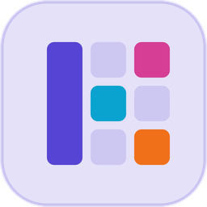
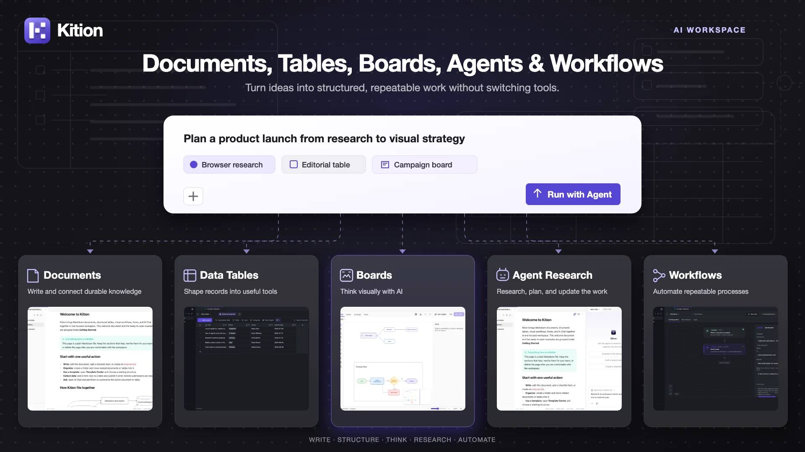
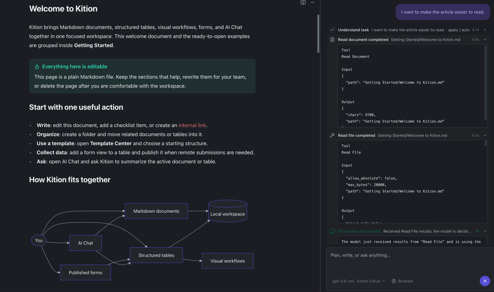
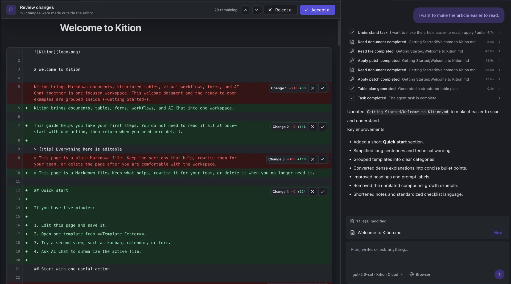
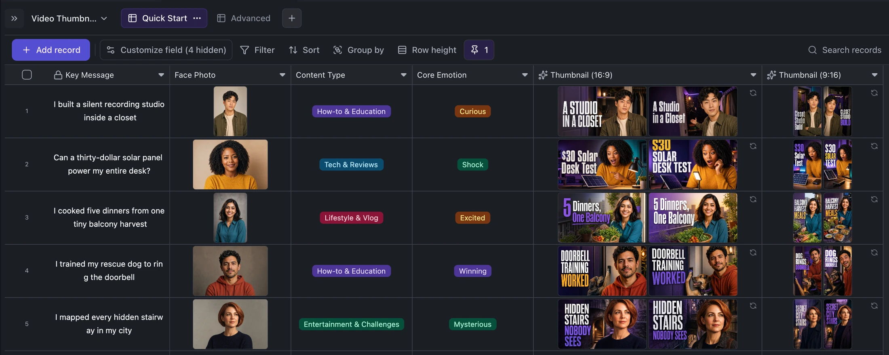
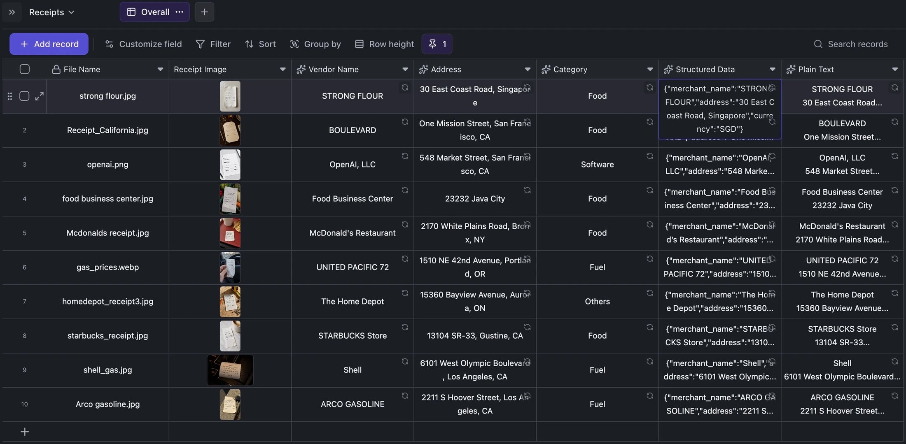
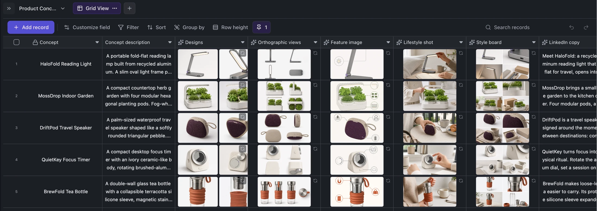

<h1 align="center">
  <a href="https://kition.ai"></a> Kition
</h1>

<p align="center">
  <a href="README.md">English</a> ·
  <a href="README.zh-CN.md">简体中文</a> ·
  <strong>Русский</strong> ·
  <a href="README.ja-JP.md">日本語</a> ·
  <a href="README.vi-VN.md">Tiếng Việt</a> ·
  <a href="README.fr-FR.md">Français</a> ·
  <a href="README.de-DE.md">Deutsch</a> ·
  <a href="README.es-ES.md">Español</a>
</p>

<p align="center">
  <strong>Документы, таблицы и агенты в едином настольном пространстве.</strong><br />
  Создавайте связанные знания, инструменты для данных и проводите веб-исследования.
</p>

<p align="center">
  <a href="https://github.com/KitionAI/kition/actions/workflows/ci.yml"></a>
  <a href="https://github.com/KitionAI/kition/releases/latest"></a>
  <a href="LICENSE"></a>
</p>

<h3 align="center"><a href="https://github.com/KitionAI/kition/releases/latest"><ins>Скачать Kition</ins></a></h3>

<p align="center">
  <a href="https://kition.ai">Сайт</a> ·
  <a href="https://github.com/KitionAI/kition/releases">Выпуски</a> ·
  <a href="CONTRIBUTING.md">Участие</a> ·
  <a href=".github/SUPPORT.md">Поддержка</a> ·
  <a href=".github/SECURITY.md">Безопасность</a>
</p>

<p align="center"></p>

Kition объединяет Markdown-документы, структурированные таблицы, AI-агента с инструментами и веб-исследования. Агент работает с редактируемыми файлами проекта, типизированными записями и вложениями, поэтому результат легче проверить, исправить и повторить.

> Kition находится на стадии бета-тестирования. Создавайте резервные копии важных рабочих пространств и проверяйте изменения агента перед использованием в производственных процессах.

## Почему Kition

- **Связанные документы.** Markdown с предпросмотром, внутренними и обратными ссылками, кодом, формулами, диаграммами, ежедневными заметками и экспортом.
- **Структурированные данные рядом со знаниями.** Типизированные поля, формулы, фильтры, группы, представления, вложения и AI-поля.
- **Агент, который может действовать.** Исследует страницы, читает и обновляет документы и таблицы, сохраняет результаты в проект.
- **Проверяемые изменения документов.** Позвольте агенту отредактировать активный документ, просмотрите каждое добавление и удаление, затем примите или отклоните отдельные изменения.

## Агент редактирует — последнее слово остаётся за вами

Вместо очередного совета, который нужно копировать и вставлять, агент Kition может прочитать активный Markdown-документ, внести точечные изменения и записать результат обратно в рабочее пространство. Документ и полный ход выполнения задачи остаются видимыми во время работы агента.

<p align="center">
  
</p>

Когда файл изменяется вне редактора, Kition открывает режим проверки документа, где выделены добавления, удаления и переписанные фрагменты. Каждое изменение можно принять или отклонить отдельно либо проверить весь набор целиком.

<p align="center">
  
</p>

Так возникает управляемый процесс работы с документом: опишите цель на естественном языке, разрешите агенту изменить настоящий файл, проверьте различия и точно решите, что останется в итоговом документе.

## Начинайте с работы, а не с пустого запроса

Контекст задачи хранится в документах, полях таблиц, записях и шаблонах. Встроенные сценарии — обычные файлы `.ktable`, которые можно адаптировать под реальный проект.

### Пакетная генерация материалов кампании

Создавайте связанные варианты миниатюр 16:9 и 9:16 для каждой записи на основе ключевого сообщения и фотографии.

<p align="center"></p>

### Преобразование чеков в доступные для поиска записи

Поля компьютерного зрения извлекают продавца, адрес, категорию, JSON и OCR-текст непосредственно в строку таблицы.

<p align="center"></p>

### Полный конвейер материалов из одного описания продукта

Создавайте варианты дизайна, ортографические виды, изображения, стилевые доски и тексты запуска, сохраняя связь с исходной записью.

<p align="center"></p>

## Основные возможности

- **Документы:** редактирование Markdown, предпросмотр, шаблоны, экспорт PDF.
- **Таблицы:** типизированные поля, вложения, формулы, фильтры, сортировка, группы и несколько представлений.
- **Агент:** обновление документов, веб-исследования, инструменты и сохранение результатов в рабочее пространство.
- **Киты:** шестнадцать встроенных редакторов, каждый для своего типа файлов (Board, CAD, Design, Doc, Film, HTML, Layout, Motion, Note, PDF, Photo, Scene, Sheet, Slide, Table, Vector). Движок каждого кита работает как WebAssembly в Web Worker, а агент редактирует те же файлы через инструменты кита.
- **Настройки:** модели, прокси, MCP, учетная запись, использование, обновления и интеграция с системой.

## Установка

Настольные сборки публикуются в [GitHub Releases](https://github.com/KitionAI/kition/releases/latest).

- **macOS:** скачайте последнюю версию `.dmg`.
- **Windows:** скачайте последний установщик.
- **Предыдущие версии:** смотрите [историю выпусков](https://github.com/KitionAI/kition/releases).

## Запуск из исходного кода

Требуются Node.js 22.19.0, pnpm 10.33.0 и Rust (stable) с [системными требованиями Tauri](https://v2.tauri.app/start/prerequisites/).

```bash
pnpm install --frozen-lockfile
pnpm dev
```

Для работы только с интерфейсом используйте `pnpm dev:web`. Дополнительные сведения: [разработка среды выполнения](docs/runtime-development.md).

## Граница открытого исходного кода

Всё настольное приложение открыто в этом репозитории: рендерер React (`src/`), настольная оболочка Tauri (`src-tauri/`), среда выполнения на Rust (`crates/`), которую оболочка запускает в том же процессе, контракты среды выполнения в [`contracts/runtime/`](contracts/runtime/), моки, тесты и упаковка. Киты разрабатываются в отдельных репозиториях; Kition поставляет их опубликованные пакеты, закреплённые по версии и контрольной сумме в [`kits/kits.lock.json`](kits/kits.lock.json).

## Технологии

| Область | Стек |
| --- | --- |
| Настольное приложение | Tauri 2 (Rust) |
| Интерфейс | React, TypeScript, Vite |
| Документы | Marked, Mermaid, KaTeX |
| Данные и состояние | IndexedDB, TanStack Query, Zod |
| Тестирование | Vitest, Playwright |

## Участие в разработке

Мы приветствуем Issue и Pull Request. Ознакомьтесь с [CONTRIBUTING.md](CONTRIBUTING.md) и [стандартом разработки Kition](docs/development-standard.md). Если изменение затрагивает и рендерер, и среду выполнения, обновляйте вместе контракт в `contracts/runtime/`, мок рендерера и среду выполнения.

## Лицензия

Kition, включая среду выполнения в `crates/`, распространяется по лицензии [Apache License 2.0](LICENSE).
