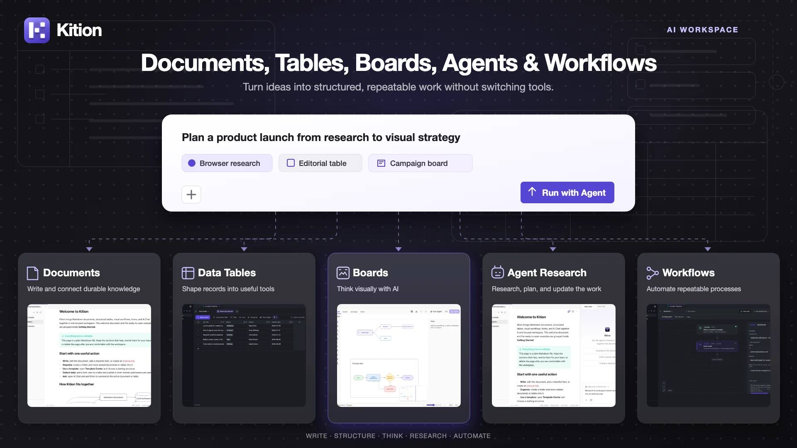
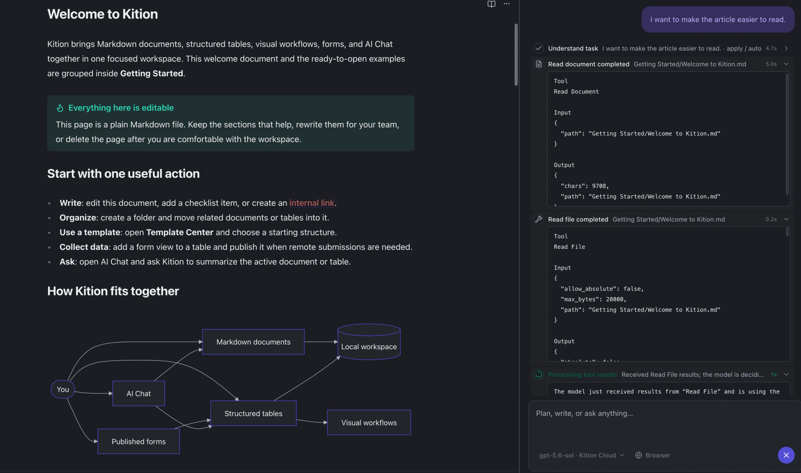
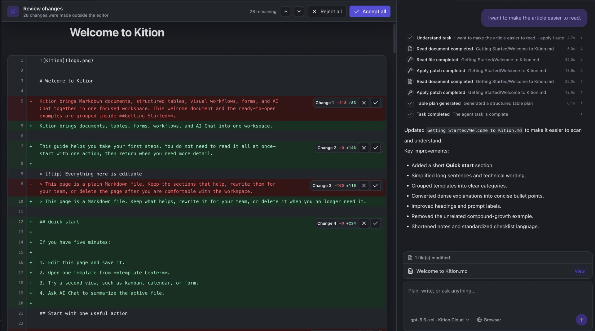
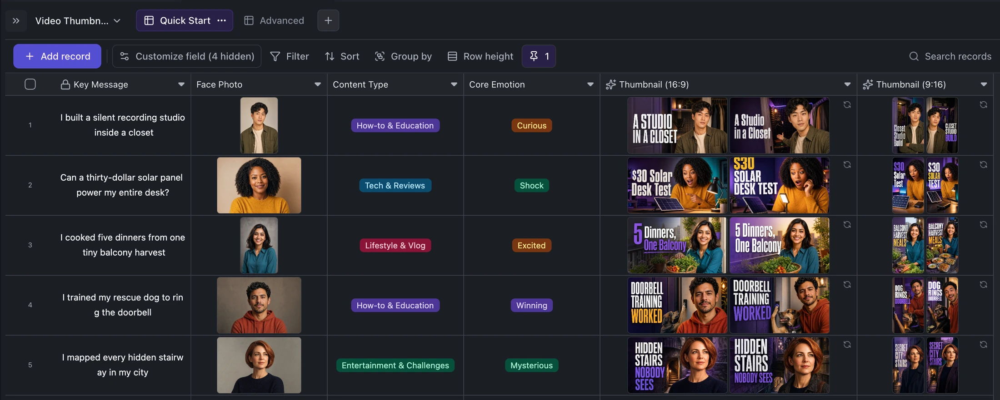
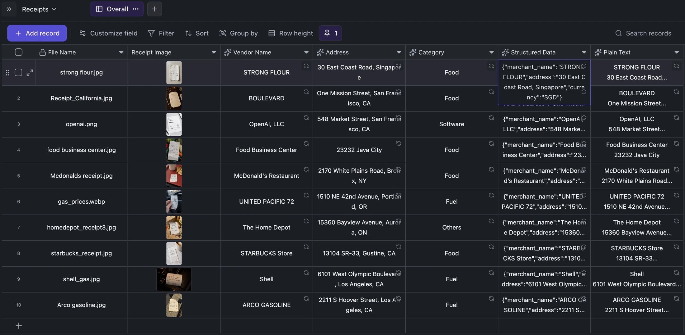
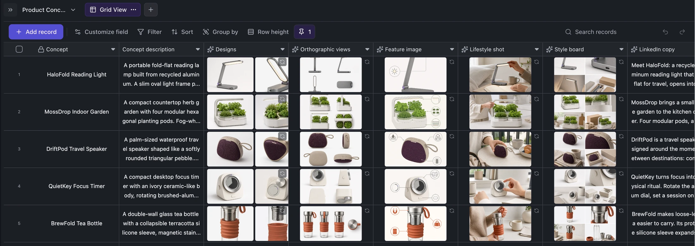

<h1 align="center">
  <a href="https://kition.ai"></a> Kition
</h1>

<p align="center">
  <a href="README.md">English</a> ·
  <strong>简体中文</strong> ·
  <a href="README.ru-RU.md">Русский</a> ·
  <a href="README.ja-JP.md">日本語</a> ·
  <a href="README.vi-VN.md">Tiếng Việt</a> ·
  <a href="README.fr-FR.md">Français</a> ·
  <a href="README.de-DE.md">Deutsch</a> ·
  <a href="README.es-ES.md">Español</a>
</p>

<p align="center">
  <strong>在一个桌面工作区中管理文档、表格与智能体。</strong><br />
  编写相互连接的知识，构建数据工具，并进行网络研究。
</p>

<p align="center">
  <a href="https://github.com/KitionAI/kition/actions/workflows/ci.yml"></a>
  <a href="https://github.com/KitionAI/kition/releases/latest"></a>
  <a href="LICENSE"></a>
</p>

<h3 align="center"><a href="https://github.com/KitionAI/kition/releases/latest"><ins>下载 Kition</ins></a></h3>

<p align="center">
  <a href="https://kition.ai">网站</a> ·
  <a href="https://github.com/KitionAI/kition/releases">发布版本</a> ·
  <a href="CONTRIBUTING.md">参与贡献</a> ·
  <a href=".github/SUPPORT.md">支持</a> ·
  <a href=".github/SECURITY.md">安全</a>
</p>

<p align="center">
  
</p>

Kition 将 Markdown 文档、结构化表格、可调用工具的 AI 智能体和网络研究整合到一个桌面工作区中。智能体可以直接使用可编辑的项目文件、类型化记录和附件，让 AI 操作更容易检查、修正和重复执行。

> Kition 目前处于测试阶段。请备份重要工作区，并在生产流程中使用前审查智能体所做的更改。

## 为什么选择 Kition

- **相互连接的文档。** 支持 Markdown 实时预览、内部链接、反向链接、标注、代码、数学公式、图表、每日笔记与导出。
- **知识旁边的结构化数据。** 使用类型化字段、公式、筛选、分组、视图、附件和 AI 字段整理研究与内容。
- **可以执行操作的智能体。** 进行网络搜索，读取和修改文档，检查表结构，并将结果保存到当前项目。
- **可审查的文档修改。** 让智能体直接编辑当前文档，逐项查看新增与删除内容，再接受或拒绝每一处变化。

## 让智能体直接修改，最终决定权仍由你掌握

Kition 智能体不只是返回一段需要复制粘贴的建议。它可以读取当前 Markdown 文档，按照自然语言要求直接修改真实文件，并在工作区中保留完整的任务执行过程。

<p align="center">
  
</p>

文件在编辑器外部发生变化后，Kition 会打开文档差异审阅界面，清晰标记新增、删除和改写内容。用户可以逐项接受或拒绝修改，也可以一次审核全部变化。

<p align="center">
  
</p>

整个流程形成一次可控的文档协作：用自然语言说明目标，让智能体修改真实文件，通过文本差异检查结果，再决定最终保留哪些内容。

## 从工作开始，而不是从空白提示词开始

Kition 把任务上下文放进熟悉的工作界面：文档、表格字段、记录和模板。内置场景使用普通 `.ktable` 文件，提示词、字段关系、生成资源和审核状态都保持可见，并可直接改造成真实项目。

### 批量生成活动素材

从核心信息和人物照片开始，通过类型化字段声明内容类型与目标情绪，再用 AI 字段为每条记录生成关联的 16:9 和 9:16 缩略图。

<p align="center"></p>

### 将票据图片转换为可搜索记录

把票据照片放入附件字段，视觉字段会在同一行中提取商户、地址、类别、结构化 JSON 和 OCR 文本。

<p align="center"></p>

### 从一份产品简介扩展出完整素材流程

一个产品概念可以生成多个设计方案、正交视图、功能图、生活方式图片、风格板和发布文案，所有结果都会保留在源记录旁边。

<p align="center"></p>

## 产品功能

- **文档：** Markdown 编辑、实时预览、标签页、模板、每日笔记以及 PDF 导出。
- **表格：** 类型化字段、附件、公式、筛选、排序、分组、多视图和快速记录编辑。
- **智能体：** 读取和更新文档、研究网页、使用工具，并将输出写回工作区。
- **套件（Kit）：** 16 个内置编辑器，各自负责一种文件（Board、CAD、Cube、Design、Doc、Effect、Fig、Film、HTML、Note、PDF、Photo、Sheet、Slide、Table、Vector）。每个套件的引擎编译为 WebAssembly，在 Web Worker 中运行；智能体通过套件的工具编辑同一份文件。
- **设置：** 模型、代理、MCP、账户、用量、更新与桌面集成设置。

## 安装

桌面版本通过 [GitHub Releases](https://github.com/KitionAI/kition/releases/latest) 发布。

- **macOS：** 下载最新的 `.dmg`。
- **Windows：** 下载最新安装程序。
- **历史版本：** 浏览完整的[发布记录](https://github.com/KitionAI/kition/releases)。

## 从源码运行

要求：Node.js 22.19.0、pnpm 10.33.0，以及 Rust（stable）和 [Tauri 系统依赖](https://v2.tauri.app/start/prerequisites/)。

```bash
pnpm install --frozen-lockfile
pnpm dev
```

仅进行渲染器、组件、编辑器或样式开发时，可以运行：

```bash
pnpm dev:web
```

更多说明参见[运行时开发](docs/runtime-development.md)。

## 开源边界

整个桌面应用都在本仓库中开源：React 渲染器（`src/`）、Tauri 桌面外壳（`src-tauri/`）、由外壳在同一进程内运行的 Rust 运行时（`crates/`）、[`contracts/runtime/`](contracts/runtime/) 中的运行时契约、模拟数据、测试和打包流程。套件在独立的仓库中开发；Kition 随应用附带它们已发布的包，并在 [`kits/kits.lock.json`](kits/kits.lock.json) 中按版本和校验和固定。

## 技术栈

| 领域 | 技术 |
| --- | --- |
| 桌面端 | Tauri 2 (Rust) |
| 界面 | React、TypeScript、Vite |
| 文档 | Marked、Mermaid、KaTeX |
| 数据与状态 | IndexedDB、TanStack Query、Zod |
| 测试 | Vitest、Playwright |

## 参与贡献

欢迎提交 Issue 和 Pull Request。请先阅读 [CONTRIBUTING.md](CONTRIBUTING.md) 和 [Kition 开发标准](docs/development-standard.md)。修改同时涉及渲染器和运行时时，请一起更新 `contracts/runtime/` 中的契约、渲染器模拟和运行时。

## 许可证

Kition（包括 `crates/` 中的运行时）采用 [Apache License 2.0](LICENSE) 许可证。
