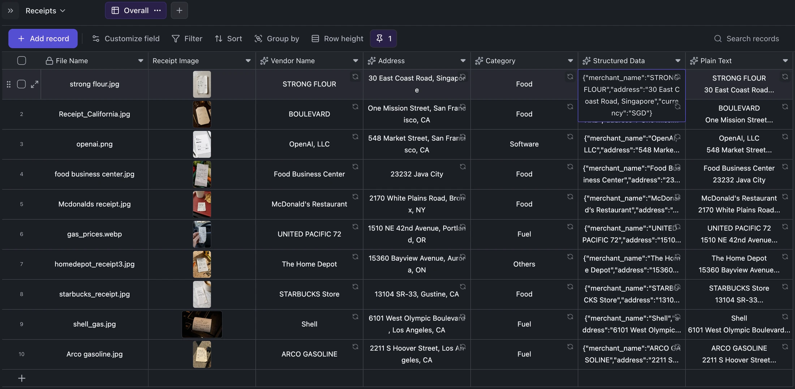

<h1 align="center">
   Kition
</h1>

  <a href="../../README.md">English</a> ·
  <a href="README.zh-CN.md">简体中文</a> ·
  <a href="README.ru-RU.md">Русский</a> ·
  <a href="README.ja-JP.md">日本語</a> ·
  <a href="README.vi-VN.md">Tiếng Việt</a> ·
  <a href="README.fr-FR.md">Français</a> ·
  <strong>Deutsch</strong> ·
  <a href="README.es-ES.md">Español</a>

  <strong>Kition: die offene Profi-Suite für KI.</strong> 
  Notizen, Tabellen, Boards und professionelle Editoren in einem Desktop-Arbeitsbereich, bearbeitet von Ihnen und Ihrem Agenten.

  
  
  
  
  
  
  
  

<h3 align="center"><a href="https://github.com/KitionAI/kition/releases/latest"><ins>Kition herunterladen</ins></a></h3>

  <a href="https://kition.ai">Website</a> ·
  <a href="https://github.com/KitionAI/kition/releases/latest">Download</a> ·
  <a href="https://github.com/KitionAI/kition/discussions">Diskussionen</a> ·
  <a href="https://discord.gg/bFSjRDjVY">Discord</a> ·
  <a href="https://www.reddit.com/r/Kition">Reddit</a> ·
  <a href="https://x.com/KitionAI">X</a> ·
  <a href="../../.github/CONTRIBUTING.md">Mitwirken</a> ·
  <a href="../../.github/SUPPORT.md">Support</a> ·
  <a href="../../.github/SECURITY.md">Sicherheit</a>

  

Kition vereint Markdown-Dokumente, strukturierte Tabellendateien, unendliche
Boards, einen werkzeugfähigen KI-Agenten und Webrecherche in einem
Desktop-Arbeitsbereich. Statt jede Aufgabe in einem leeren Chat beginnen zu
lassen, gibt Kition dem Agenten bearbeitbare Projektdateien, typisierte
Datensätze und Anhänge, mit denen er arbeiten kann. So lässt sich KI-Arbeit
leichter prüfen, korrigieren und wiederholen, ohne Kontext zwischen getrennten
Werkzeugen weiterzureichen.

> Kition befindet sich derzeit in der Beta-Phase. Sichern Sie wichtige
> Arbeitsbereiche und prüfen Sie Änderungen des Agenten, bevor Sie sich in
> produktiven Abläufen darauf verlassen.

## Warum Kition

- **Vernetzte Dokumente.** Schreiben Sie Markdown mit Live-Vorschau, Links,
  Backlinks, Hinweisblöcken, Code, Mathematik, Diagrammen, täglichen Notizen
  und Export.
- **Strukturierte Daten neben dem Wissen.** Machen Sie aus Recherche und
  Inhalten typisierte Datensätze, Formeln, Filter, Gruppen, Ansichten, Anhänge
  und KI-Felder.
- **Visuelles Denken mit prüfbaren KI-Änderungen.** Erstellen Sie Diagramme,
  Mindmaps, Abläufe und freie Skizzen auf einem Board und prüfen Sie die
  Änderungen des Agenten, bevor Sie sie übernehmen.
- **Ein Agent, der handeln kann.** Er durchsucht das Web, untersucht Dokumente
  und Tabellenschemata, aktualisiert Inhalte und speichert nützliche Ergebnisse
  im aktiven Projekt.
- **Prüfbare Dokumentänderungen.** Lassen Sie den Agenten das aktive Dokument
  bearbeiten, prüfen Sie jede Ergänzung und Löschung und nehmen Sie dann
  einzelne Änderungen an oder lehnen Sie sie ab.
- **Kits für jede Art von Datei.** Sechzehn Kits in vier Produktlinien öffnen
  Tabellenkalkulationen, Folien, Fotos, Filme, CAD-Zeichnungen und mehr als
  gewöhnliche Dateien im Arbeitsbereich, und der Agent bearbeitet sie über die
  Werkzeuge des jeweiligen Kits. Siehe [Kits](#kits).

## Den Agenten bearbeiten lassen – die Entscheidung bleibt bei Ihnen

Statt einen weiteren Vorschlag zum Kopieren und Einfügen zurückzugeben, kann
der Kition-Agent das aktive Markdown-Dokument lesen, gezielte Änderungen
vornehmen und das Ergebnis in den Arbeitsbereich zurückschreiben. Dokument und
vollständiger Aufgabenverlauf bleiben gemeinsam sichtbar, während der Agent
arbeitet.

  

Wenn sich eine Datei außerhalb des Editors ändert, öffnet Kition eine
Dokumentprüfung, die Ergänzungen, Löschungen und umgeschriebene Stellen
hervorhebt. Jede Änderung lässt sich einzeln annehmen oder ablehnen;
alternativ kann die gesamte Bearbeitung als Einheit geprüft werden.

  

So entsteht ein kontrollierter Dokumentablauf: Beschreiben Sie das Ziel in
natürlicher Sprache, lassen Sie den Agenten die echte Datei bearbeiten, prüfen
Sie den Unterschied und entscheiden Sie genau, was im endgültigen Dokument
verbleibt.

## Mit der Arbeit beginnen, nicht mit einer leeren Eingabe

Ein leistungsfähiger Agent ist nützlich, doch eine leere Eingabe verlangt vom
Nutzer weiterhin, die Aufgabe zu entwerfen, alle Eingangsdaten zu beschreiben,
ein Ausgabeformat zu wählen und gegenzusteuern, wenn ein Schritt schiefgeht.
Kition verlagert diese Komplexität in vertraute Arbeitsflächen: Dokumente,
Tabellenfelder, Datensätze und Vorlagen.

Die integrierten Szenarien unten sind gewöhnliche `.ktable`-Dateien. Ihre
Prompts, Feldbeziehungen, erzeugten Materialien und Prüfstatus bleiben sichtbar
und lassen sich an ein echtes Projekt anpassen.

### Kampagnenmaterial stapelweise erzeugen

Beginnen Sie mit einer Kernbotschaft und einem Porträtfoto. Typisierte Felder
halten Inhaltstyp und beabsichtigte Emotion ausdrücklich fest, während KI-Felder
für jeden Datensatz verknüpfte Miniaturvarianten in 16:9 und 9:16 erzeugen. Die
Tabelle wird so zugleich zur Stapel-Warteschlange und zur Prüffläche.

  

### Belegbilder in durchsuchbare Datensätze umwandeln

Ziehen Sie Belegfotos in ein Anhangsfeld. Felder mit Bilderkennung extrahieren
Händler, Adresse, Kategorie, strukturiertes JSON und reinen OCR-Text direkt in
dieselbe Zeile. Die Ergebnisse lassen sich anschließend filtern, korrigieren
oder vom Agenten zusammenfassen.

  

### Aus einem Produktbriefing eine vollständige Materialkette erstellen

Ein einziges Produktkonzept kann mehrere Designentwürfe, orthografische
Ansichten, ein Funktionsbild, eine Lifestyle-Aufnahme, eine Stiltafel und
Einführungstexte hervorbringen. Jedes Ergebnis bleibt mit dem Quelldatensatz
verbunden, sodass sich die gesamte Kette leichter vergleichen, neu erzeugen und
übergeben lässt als eine Sammlung unverbundener Chat-Ausgaben.

  

Diese Szenarien zeigen den Arbeitszyklus, für den Kition gedacht ist: Nutzen
Sie Dokumente für den erzählenden Kontext, Tabellen für den strukturierten
Zustand, Boards für visuelles Denken und den Agenten für Arbeit mit offenem
Ausgang.

## Produktrundgang

<table>
<tr>
<td width="42%" valign="middle">

### Vernetzte Dokumente schreiben

Schreiben Sie Markdown mit Live-Vorschau, internen Links, Backlinks, Tags,
Gliederungen, Einbettungen, Hinweisblöcken, Code, Mathematik, Diagrammen,
Vorlagen, täglichen Notizen und Tabs. Exportieren Sie fertige Arbeit als PDF,
wenn sie den Arbeitsbereich verlassen soll.

</td>
<td width="58%">
  
</td>
</tr>
<tr>
<td width="58%">
  
</td>
<td width="42%" valign="middle">

### Daten in nützliche Werkzeuge verwandeln

Erstellen Sie strukturierte Tabellendateien mit typisierten Feldern, Anhängen,
Formeln, Filtern, Sortierung, Gruppierung, mehreren Ansichten und schneller
Bearbeitung von Datensätzen. Nutzen Sie sie für Recherche, Content-Pipelines,
ein schlankes CRM, Bestandsverwaltung oder Projektverfolgung.

</td>
</tr>
<tr>
<td width="42%" valign="middle">

### Dem Agenten echten Kontext geben

Bitten Sie den Kition-Agenten, Dokumente zu lesen und zu aktualisieren,
Tabellenschemata zu untersuchen, Datensätze anzulegen oder zu ändern, im Web zu
suchen, Werkzeuge zu nutzen und einem Plan zu folgen. Ergebnisse des Agenten
lassen sich in den aktiven Arbeitsbereich zurückschreiben.

</td>
<td width="58%">
  
</td>
</tr>
<tr>
<td width="58%">
  
</td>
<td width="42%" valign="middle">

### Visuell denken und planen

Erstellen Sie Diagramme, Mindmaps, Flussdiagramme, Gruppen von Haftnotizen und
freie Skizzen auf einer unendlichen Leinwand. Boards sind `.kboard`-Dateien,
die das Board-Kit bearbeitet, und der Agent arbeitet über die Werkzeuge des
Kits mit ihnen, live oder als Entwurf, den Sie prüfen, bevor er Teil des
Arbeitsbereichs wird.

</td>
</tr>
</table>

## Kits

Ein Kit ist ein Editor für eine Art von Datei. Seine Engine ist zu WebAssembly
kompiliert und läuft in einem Web Worker, und das Kit zeichnet seinen eigenen
Editor innerhalb von Kition. Der Agent bearbeitet dieselben Dateien über die
Werkzeuge des Kits, sodass seine Änderungen sichtbar und prüfbar bleiben. Die
Kits von Kition gibt es in vier Produktlinien; die Pakete, die Kition
ausliefert, sind in [`kits/kits.lock.json`](../../kits/kits.lock.json)
festgeschrieben.

  

Jedes Bild ist eine Datei, die ein Kit mit seinen eigenen Befehlen erstellt und
mit seiner eigenen Engine gerendert hat; weitere finden Sie in
[Kition Showcase](https://github.com/KitionAI/kition-showcase).

| Produktlinie | Kit | Bearbeitet | Öffnet | Erstellt |
| --- | --- | --- | --- | --- |
| Büro | [Note](https://github.com/KitionAI/kition-note) | Markdown-Notizen, Byte für Byte gespeichert | `.md` `.markdown` | `.md` |
| Büro | [Table](https://github.com/KitionAI/kition-table) | Tabellen, Ansichten und Dashboards in einer Datei | `.ktable` | `.ktable` |
| Büro | [Board](https://github.com/KitionAI/kition-board) | Ein unendliches Whiteboard für Diagramme, Mindmaps und Skizzen | `.kboard` | `.kboard` |
| Büro | [Doc](https://github.com/KitionAI/kition-doc) | Textdokumente (`.docx`) | `.docx` `.html` `.htm` | `.docx` |
| Büro | [Sheet](https://github.com/KitionAI/kition-sheet) | Tabellenkalkulationen (`.xlsx`) mit Formeln | `.xlsx` `.xlsm` `.xltx` `.xltm` `.xls` `.xlt` `.et` `.ett` `.xlsb` `.ods` `.csv` | `.xlsx` |
| Büro | [Slide](https://github.com/KitionAI/kition-slide) | Folien, einschließlich `.pptx`-Dateien | `.kslide` `.pptx` | `.kslide` |
| Büro | [PDF](https://github.com/KitionAI/kition-pdf) | PDF-Dateien lesen und bearbeiten | `.pdf` | `.pdf` |
| Büro | [HTML](https://github.com/KitionAI/kition-html) (Vorschau) | HTML-Seiten mit Live-Vorschau | `.html` `.htm` | `.html` |
| Design | [Photo](https://github.com/KitionAI/kition-photo) | Bilder mit Ebenen, einschließlich `.psd`-Dateien | `.psd` `.psb` `.kphoto` | `.psd` |
| Design | [Vector](https://github.com/KitionAI/kition-vector) | Vektorgrafiken | `.kvector` `.svg` `.ai` `.eps` | `.kvector` |
| Design | [Layout](https://github.com/KitionAI/kition-layout) | Seitenlayouts: Flyer, Plakate und Bücher | `.klayout` `.idml` | `.klayout` |
| Design | [Design](https://github.com/KitionAI/kition-design) (Vorschau) | Designs für Benutzeroberflächen und Bildschirme | `.kdesign` `.fig` `.sketch` | `.kdesign` |
| Medien | [Film](https://github.com/KitionAI/kition-film) | Video-Zeitleisten | `.kfilm` | `.kfilm` |
| Medien | [Motion](https://github.com/KitionAI/kition-motion) | Animierte Grafiken mit Keyframes und Effekten | `.kmotion` | `.kmotion` |
| Technik | [CAD](https://github.com/KitionAI/kition-cad) | 2D-CAD-Zeichnungen (`.dxf`) | `.dxf` | `.dxf` |
| Technik | [Scene](https://github.com/KitionAI/kition-scene) (Vorschau) | 3D-Szenen | `.kscene` | `.kscene` |

Mit Vorschau gekennzeichnete Kits befinden sich in einem frühen Stadium:
Rechnen Sie mit Lücken. Alle sechzehn werden mit Kition ausgeliefert.

Jedes Kit wird in einem eigenen Repository entwickelt; unter
[Kits](../kits.md) erfahren Sie, wie Kits in Kition eingebunden werden.

Außerdem enthalten:

- KI-gestützte Tabellenfelder, die aus dem Kontext eines Datensatzes Text,
  strukturierte Werte und Medien erzeugen.
- Einstellungen für Modelle, Proxy, MCP, Konto, Nutzung, Aktualisierungen und
  Desktop-Integration.
- Ein vorbefüllter Arbeitsbereich „Getting Started“ mit praxisnahen Beispielen
  für Dokumente und Tabellen.

## Installation

Desktop-Versionen werden über
[GitHub Releases](https://github.com/KitionAI/kition/releases/latest)
veröffentlicht.

- **macOS (Apple Silicon oder Intel):** Laden Sie die neueste `.dmg`-Datei
  herunter.
- **Windows (x64):** Laden Sie das neueste Installationsprogramm `-setup.exe`
  herunter.
- **Linux (experimentell):** Laden Sie das neueste `.AppImage` für x86_64
  herunter.
- **Frühere Versionen:** Durchsuchen Sie den vollständigen
  [Versionsverlauf](https://github.com/KitionAI/kition/releases).

## Open-Source-Grenze

Alles, was die Kition-Desktop-App ausmacht, ist in diesem Repository
quelloffen:

- der React-Renderer (`src/`): die Oberfläche für Dokumente, Tabellen, Agent,
  Einstellungen, Szenarien und Kit-Host;
- die Tauri-Desktop-Shell (`src-tauri/`) und die Desktop-Integration;
- die Rust-Runtime (`crates/`), die die Shell im selben Prozess ausführt und
  die ihre HTTP-API nur auf Loopback bereitstellt. Siehe
  [Runtime-Entwicklung](../runtime-development.md);
- die Runtime-Verträge in [`contracts/runtime/`](../../contracts/runtime/),
  Mocks, Fixtures und Black-Box-Tests;
- die festgelegten Kit-Versionen (`kits/`) sowie die Paketierungs- und
  Release-Workflows.

Kits werden in separaten Repositories entwickelt. Kition liefert das
veröffentlichte Paket jedes Kits aus, mit Version und Prüfsumme festgelegt in
[`kits/kits.lock.json`](../../kits/kits.lock.json).

## Mitwirken

Issues und Pull Requests sind willkommen. Wie Sie Kition aus dem Quellcode
ausführen, wie das Repository aufgebaut ist und welche Technologien es
verwendet, steht in [CONTRIBUTING.md](../../.github/CONTRIBUTING.md).

1. Halten Sie sich an den [Kition-Entwicklungsstandard](../development-standard.md),
   einschließlich des empfohlenen Orca-Worktree-Workflows.
2. Wenn eine Änderung Renderer und Runtime betrifft, aktualisieren Sie den
   Vertrag in `contracts/runtime/`, den Renderer-Mock und die Runtime gemeinsam.
3. Melden Sie sicherheitsrelevante Probleme über
   [.github/SECURITY.md](../../.github/SECURITY.md), nicht in einem öffentlichen
   Issue.

Für Produktfragen, Hilfe zum Konto und Anliegen zu privaten Arbeitsbereichen
lesen Sie [.github/SUPPORT.md](../../.github/SUPPORT.md).

## Lizenz

Kition, einschließlich seiner Runtime in `crates/`, steht unter der Lizenz
Apache-2.0 ([LICENSE](../../LICENSE)).
