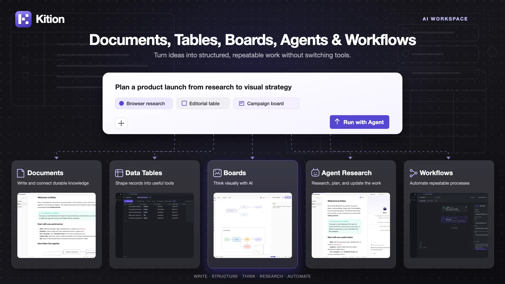
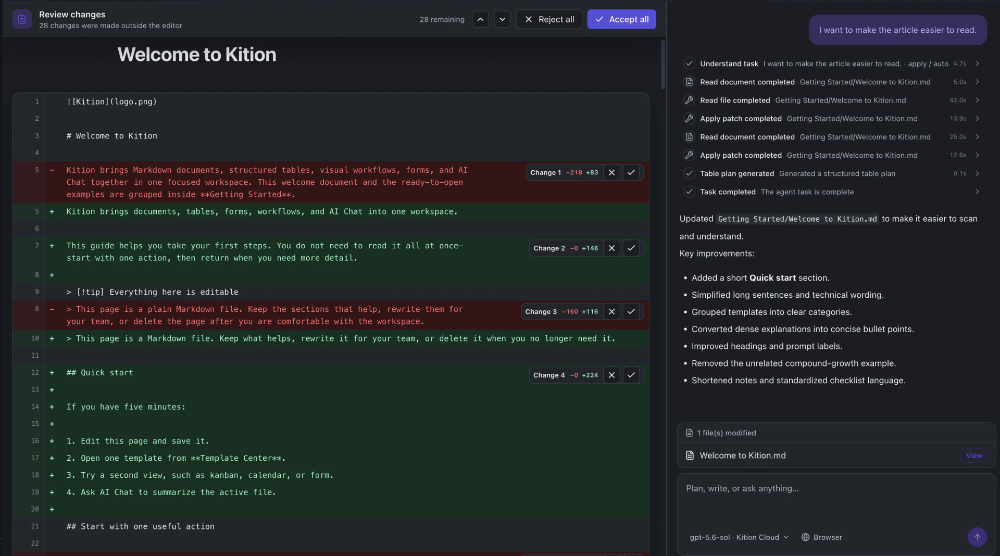
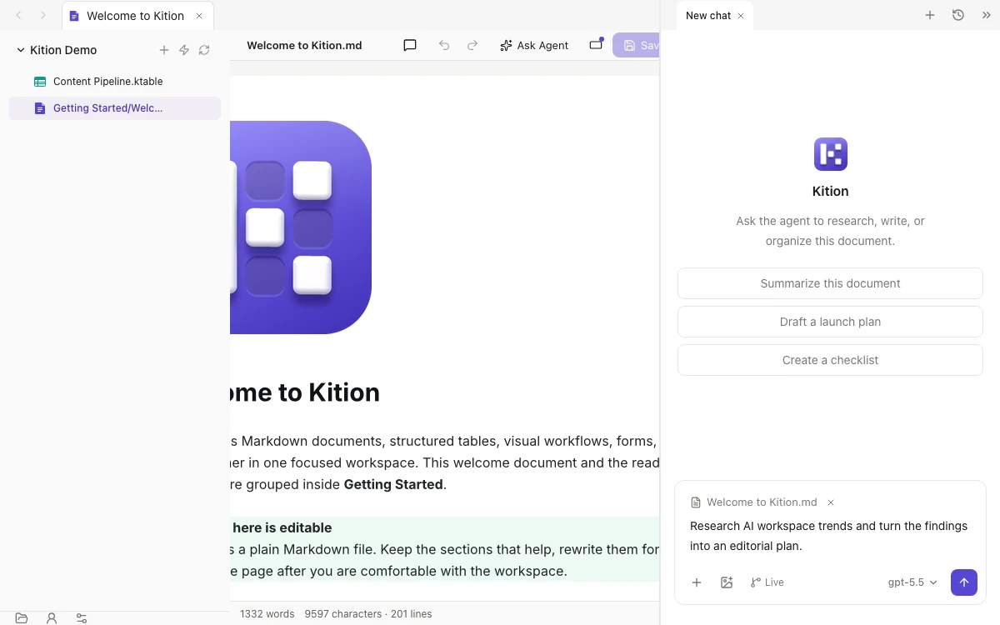
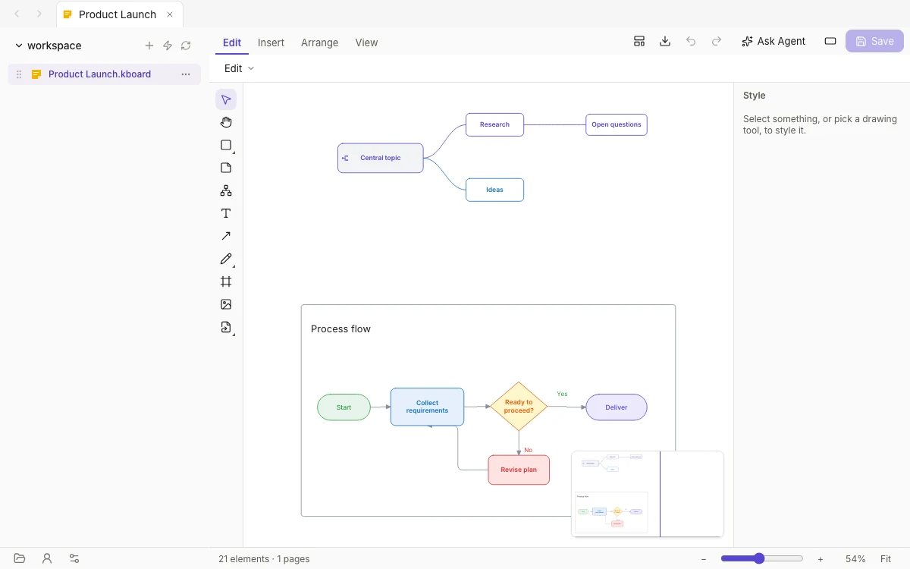

<h1 align="center">
   Kition
</h1>

  <a href="../../README.md">English</a> ·
  <a href="README.zh-CN.md">简体中文</a> ·
  <a href="README.ru-RU.md">Русский</a> ·
  <a href="README.ja-JP.md">日本語</a> ·
  <a href="README.vi-VN.md">Tiếng Việt</a> ·
  <a href="README.fr-FR.md">Français</a> ·
  <a href="README.de-DE.md">Deutsch</a> ·
  <strong>Español</strong>

  <strong>Kition: la suite profesional abierta para la IA.</strong> 
  Notas, tablas, tableros y editores profesionales en un único espacio de trabajo de escritorio, editados por ti y por tu agente.

  
  
  
  
  
  
  
  

<h3 align="center"><a href="https://github.com/KitionAI/kition/releases/latest"><ins>Descargar Kition</ins></a></h3>

  <a href="https://kition.ai">Sitio web</a> ·
  <a href="https://github.com/KitionAI/kition/releases/latest">Descargar</a> ·
  <a href="https://github.com/KitionAI/kition/discussions">Debates</a> ·
  <a href="https://discord.gg/bFSjRDjVY">Discord</a> ·
  <a href="https://www.reddit.com/r/Kition">Reddit</a> ·
  <a href="https://x.com/KitionAI">X</a> ·
  <a href="../../.github/CONTRIBUTING.md">Contribuir</a> ·
  <a href="../../.github/SUPPORT.md">Soporte</a> ·
  <a href="../../.github/SECURITY.md">Seguridad</a>

  

Kition reúne en un único espacio de trabajo de escritorio documentos Markdown,
archivos de tablas estructuradas, Boards infinitos, un agente de IA capaz de usar
herramientas e investigación web. En lugar de que cada tarea empiece en un chat
vacío, Kition da al agente archivos de proyecto editables, registros tipados y
adjuntos con los que trabajar. Así resulta más fácil revisar, corregir y repetir
el trabajo de la IA sin pasar el contexto de una herramienta desconectada a otra.

> Kition se encuentra actualmente en beta. Haz copias de seguridad de los espacios
> de trabajo importantes y revisa los cambios del agente antes de confiar en ellos
> en flujos de trabajo de producción.

## Por qué Kition

- **Documentos conectados.** Escribe Markdown con vista previa en directo, enlaces,
  backlinks, bloques destacados, código, matemáticas, diagramas, notas diarias y
  exportación.
- **Datos estructurados junto al conocimiento.** Convierte la investigación y el
  contenido en registros tipados, fórmulas, filtros, grupos, vistas, adjuntos y
  campos de IA.
- **Pensamiento visual con cambios de la IA revisables.** Crea diagramas, mapas
  mentales, flujos y bocetos libres en un Board, y revisa los cambios del agente
  antes de conservarlos.
- **Un agente que puede actuar.** Busca en la web, examina documentos y esquemas
  de tablas, actualiza contenido y guarda los resultados útiles en el proyecto activo.
- **Ediciones de documentos revisables.** Deja que el agente edite el documento
  activo, revisa cada adición y eliminación, y acepta o rechaza los cambios de
  forma individual.
- **Kits para cada tipo de archivo.** Dieciséis kits en cuatro líneas de producto
  abren hojas de cálculo, diapositivas, fotos, películas, planos CAD y más como
  archivos normales del espacio de trabajo, y el agente trabaja con ellos mediante
  las herramientas de cada kit. Consulta [Kits](#kits).

## Deja que el agente edite: la última palabra es tuya

En lugar de devolver otra sugerencia para copiar y pegar, el agente de Kition
puede leer el documento Markdown activo, realizar cambios acotados y escribir el
resultado de nuevo en el espacio de trabajo. El documento y el registro completo
de la tarea permanecen visibles a la vez mientras el agente trabaja.

  

Cuando un archivo cambia fuera del editor, Kition abre una vista de revisión del
documento que resalta las adiciones, eliminaciones y reescrituras. Cada cambio se
puede aceptar o rechazar por separado, o bien se puede revisar toda la edición
como un único conjunto.

  

Así se crea un flujo de trabajo documental controlado: describe el objetivo en
lenguaje natural, deja que el agente edite el archivo real, revisa las
diferencias y decide exactamente qué queda en el documento final.

## Empieza con el trabajo, no con un mensaje vacío

Un agente capaz es útil, pero un mensaje vacío sigue obligando al usuario a
diseñar la tarea, describir cada entrada, elegir un formato de salida y
recuperarse cuando un paso falla. Kition traslada esa complejidad a superficies
de trabajo conocidas: documentos, campos de tabla, registros y plantillas.

Los escenarios integrados que se muestran a continuación son archivos `.ktable`
normales. Sus instrucciones, relaciones entre campos, recursos generados y
estados de revisión permanecen visibles y se pueden adaptar a un proyecto real.

### Generar recursos de campaña por lotes

Empieza con un mensaje clave y una foto de un rostro. Los campos tipados dejan
explícitos el tipo de contenido y la emoción buscada, mientras que los campos de
IA generan variantes de miniatura vinculadas en 16:9 y 9:16 para cada registro.
La tabla se convierte a la vez en la cola del lote y en la superficie de revisión.

  

### Convertir imágenes de recibos en registros consultables

Arrastra fotos de recibos a un campo de adjuntos. Los campos basados en visión
extraen el comercio, la dirección, la categoría, JSON estructurado y texto OCR
sin formato directamente en la misma fila. Después, el agente puede filtrar,
corregir o resumir los resultados.

  

### Ampliar una descripción de producto a una cadena completa de recursos

Un solo concepto de producto puede dar lugar a varias propuestas de diseño,
vistas ortográficas, una imagen destacada, una escena de uso, un panel de estilo
y textos de lanzamiento. Cada resultado permanece vinculado al registro de
origen, por lo que la cadena completa es más fácil de comparar, regenerar y
entregar que una colección de respuestas de chat desconectadas.

  

Estos escenarios muestran el ciclo de trabajo previsto en Kition: documentos
para el contexto narrativo, tablas para el estado estructurado, Boards para el
pensamiento visual y el agente para el trabajo incierto.

## Recorrido por el producto

<table>
<tr>
<td width="42%" valign="middle">

### Escribe documentos conectados

Escribe Markdown con vista previa en directo, enlaces internos, backlinks,
etiquetas, esquemas, contenido incrustado, bloques destacados, código,
matemáticas, diagramas, plantillas, notas diarias y pestañas. Exporta el trabajo
terminado a PDF cuando tenga que salir del espacio de trabajo.

</td>
<td width="58%">
  
</td>
</tr>
<tr>
<td width="58%">
  
</td>
<td width="42%" valign="middle">

### Convierte los datos en herramientas útiles

Crea archivos de tablas estructuradas con campos tipados, adjuntos, fórmulas,
filtros, ordenación, agrupación, varias vistas y edición rápida de registros.
Úsalos para investigación, cadenas de contenido, un CRM ligero, inventario o
seguimiento de proyectos.

</td>
</tr>
<tr>
<td width="42%" valign="middle">

### Da al agente contexto real

Pide al agente de Kition que lea y actualice documentos, examine esquemas de
tablas, cree o modifique registros, busque en la web, use herramientas y siga un
plan. El resultado del agente se puede escribir de nuevo en el espacio de
trabajo activo.

</td>
<td width="58%">
  
</td>
</tr>
<tr>
<td width="58%">
  
</td>
<td width="42%" valign="middle">

### Piensa y planifica de forma visual

Crea diagramas, mapas mentales, diagramas de flujo, grupos de notas adhesivas y
bocetos libres en un lienzo infinito. Los Boards son archivos `.kboard` que edita
el kit Board, y el agente trabaja con ellos mediante las herramientas del kit, en
directo o como un borrador que revisas antes de que pase a formar parte del
espacio de trabajo.

</td>
</tr>
</table>

## Kits

Un kit es un editor para un tipo de archivo. Su motor está compilado a
WebAssembly y se ejecuta en un Web Worker, y el kit dibuja su propio editor
dentro de Kition. El agente edita los mismos archivos mediante las herramientas
del kit, de modo que sus cambios siguen siendo visibles y revisables. Los kits de
Kition se agrupan en cuatro líneas de producto; los paquetes que incluye Kition
están fijados en [`kits/kits.lock.json`](../../kits/kits.lock.json).

  

Cada imagen es un archivo que un kit creó con sus propios comandos y renderizó
con su propio motor; hay más en
[Kition Showcase](https://github.com/KitionAI/kition-showcase).

| Línea de producto | Kit | Edita | Abre | Crea |
| --- | --- | --- | --- | --- |
| Ofimática | [Note](https://github.com/KitionAI/kition-note) | Notas Markdown, guardadas byte a byte | `.md` `.markdown` | `.md` |
| Ofimática | [Table](https://github.com/KitionAI/kition-table) | Tablas, vistas y paneles en un solo archivo | `.ktable` | `.ktable` |
| Ofimática | [Board](https://github.com/KitionAI/kition-board) | Una pizarra infinita para diagramas, mapas mentales y bocetos | `.kboard` | `.kboard` |
| Ofimática | [Doc](https://github.com/KitionAI/kition-doc) | Documentos de texto (`.docx`) | `.docx` `.html` `.htm` | `.docx` |
| Ofimática | [Sheet](https://github.com/KitionAI/kition-sheet) | Hojas de cálculo (`.xlsx`) con fórmulas | `.xlsx` `.xlsm` `.xltx` `.xltm` `.xls` `.xlt` `.et` `.ett` `.xlsb` `.ods` `.csv` | `.xlsx` |
| Ofimática | [Slide](https://github.com/KitionAI/kition-slide) | Diapositivas, incluidos archivos `.pptx` | `.kslide` `.pptx` | `.kslide` |
| Ofimática | [PDF](https://github.com/KitionAI/kition-pdf) | Lectura y edición de archivos PDF | `.pdf` | `.pdf` |
| Ofimática | [HTML](https://github.com/KitionAI/kition-html) (Preliminar) | Páginas HTML, con vista previa en directo | `.html` `.htm` | `.html` |
| Diseño | [Photo](https://github.com/KitionAI/kition-photo) | Imágenes con capas, incluidos archivos `.psd` | `.psd` `.psb` `.kphoto` | `.psd` |
| Diseño | [Vector](https://github.com/KitionAI/kition-vector) | Gráficos vectoriales | `.kvector` `.svg` `.ai` `.eps` | `.kvector` |
| Diseño | [Layout](https://github.com/KitionAI/kition-layout) | Maquetación de páginas: folletos, carteles y libros | `.klayout` `.idml` | `.klayout` |
| Diseño | [Design](https://github.com/KitionAI/kition-design) (Preliminar) | Diseños de interfaces y pantallas | `.kdesign` `.fig` `.sketch` | `.kdesign` |
| Multimedia | [Film](https://github.com/KitionAI/kition-film) | Líneas de tiempo de vídeo | `.kfilm` | `.kfilm` |
| Multimedia | [Motion](https://github.com/KitionAI/kition-motion) | Gráficos animados con fotogramas clave y efectos | `.kmotion` | `.kmotion` |
| Ingeniería | [CAD](https://github.com/KitionAI/kition-cad) | Planos CAD 2D (`.dxf`) | `.dxf` | `.dxf` |
| Ingeniería | [Scene](https://github.com/KitionAI/kition-scene) (Preliminar) | Escenas 3D | `.kscene` | `.kscene` |

Los kits marcados como Preliminar están en una fase temprana: cabe esperar
carencias. Los dieciséis se incluyen con Kition.

Cada kit se desarrolla en su propio repositorio; consulta
[Kits](../kits.md) para ver cómo se integran los kits en Kition.

También se incluye:

- Campos de tabla asistidos por IA para generar texto, valores estructurados y
  contenido multimedia a partir del contexto del registro.
- Ajustes de modelo, proxy, MCP, cuenta, uso, actualizaciones e integración con
  el escritorio.
- Un espacio de trabajo de introducción precargado con ejemplos prácticos de
  documentos y tablas.

## Instalación

Las compilaciones de escritorio se publican mediante
[GitHub Releases](https://github.com/KitionAI/kition/releases/latest).

- **macOS (Apple silicon o Intel):** descarga el `.dmg` más reciente.
- **Windows (x64):** descarga el instalador `-setup.exe` más reciente.
- **Linux (experimental):** descarga el `.AppImage` x86_64 más reciente.
- **Versiones anteriores:** consulta el
  [historial completo de versiones](https://github.com/KitionAI/kition/releases).

## Límite del código abierto

Todo lo que compone la aplicación de escritorio Kition es de código abierto en
este repositorio:

- el renderizador React (`src/`): la interfaz de documentos, tablas, agente,
  ajustes, escenarios y alojamiento de kits;
- el shell de escritorio Tauri (`src-tauri/`) y la integración con el escritorio;
- el runtime en Rust (`crates/`), que el shell ejecuta en el mismo proceso y que
  sirve su API HTTP solo en loopback. Consulta
  [Desarrollo del runtime](../runtime-development.md);
- los contratos del runtime en [`contracts/runtime/`](../../contracts/runtime/),
  mocks, fixtures y pruebas de caja negra;
- las versiones fijadas de los kits (`kits/`) y los flujos de empaquetado y
  publicación.

Los kits se desarrollan en repositorios separados. Kition incluye el paquete
publicado de cada kit, fijado por versión y suma de comprobación en
[`kits/kits.lock.json`](../../kits/kits.lock.json).

## Contribuir

Se aceptan issues y pull requests. En
[CONTRIBUTING.md](../../.github/CONTRIBUTING.md) encontrarás cómo ejecutar Kition
desde el código fuente, la estructura del repositorio y la tecnología que utiliza.

1. Sigue el [estándar de desarrollo de Kition](../development-standard.md),
   incluido el flujo de trabajo recomendado con worktrees de Orca.
2. Cuando un cambio afecte tanto al renderizador como al runtime, actualiza a la
   vez el contrato en `contracts/runtime/`, el mock del renderizador y el runtime.
3. Informa de los problemas de seguridad sensibles a través de
   [.github/SECURITY.md](../../.github/SECURITY.md), no en un issue público.

Para preguntas sobre el producto, ayuda con la cuenta y asuntos relacionados con
espacios de trabajo privados, consulta [.github/SUPPORT.md](../../.github/SUPPORT.md).

## Licencia

Kition, incluido su runtime en `crates/`, se distribuye bajo la licencia
Apache-2.0 ([LICENSE](../../LICENSE)).
