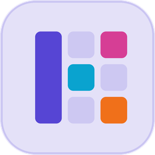
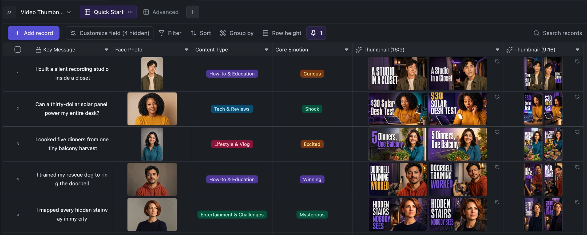
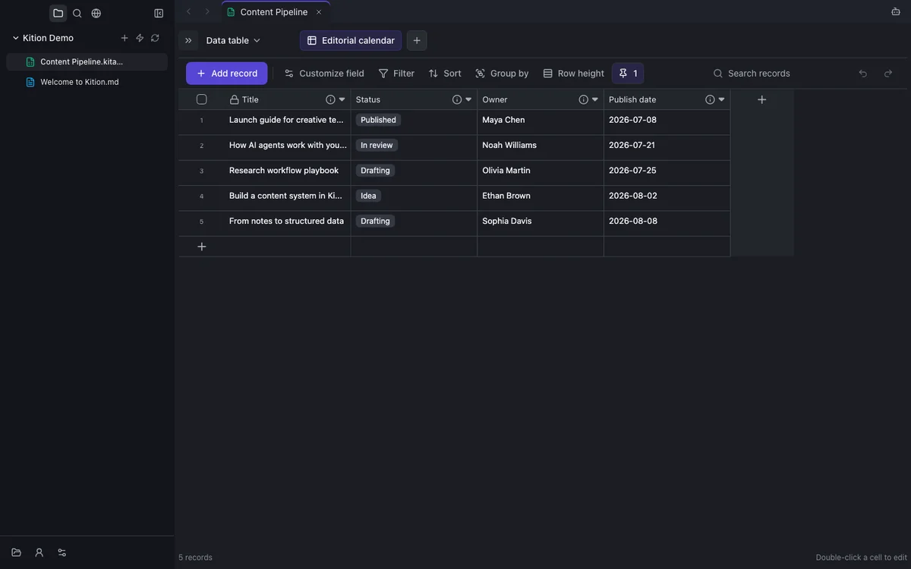

<h1 align="center">
   Kition
</h1>

  <a href="../../README.md">English</a> ·
  <a href="README.zh-CN.md">简体中文</a> ·
  <a href="README.ru-RU.md">Русский</a> ·
  <a href="README.ja-JP.md">日本語</a> ·
  <a href="README.vi-VN.md">Tiếng Việt</a> ·
  <strong>Français</strong> ·
  <a href="README.de-DE.md">Deutsch</a> ·
  <a href="README.es-ES.md">Español</a>

  <strong>Kition : la suite pro ouverte pour l’IA.</strong> 
  Notes, tableaux, Boards et éditeurs professionnels réunis dans un seul espace de travail de bureau, modifiés par vous et par votre agent.

  
  
  
  
  
  
  
  

<h3 align="center"><a href="https://github.com/KitionAI/kition/releases/latest"><ins>Télécharger Kition</ins></a></h3>

  <a href="https://kition.ai">Site web</a> ·
  <a href="https://github.com/KitionAI/kition/releases/latest">Télécharger</a> ·
  <a href="https://github.com/KitionAI/kition/discussions">Discussions</a> ·
  <a href="https://discord.gg/bFSjRDjVY">Discord</a> ·
  <a href="https://www.reddit.com/r/Kition">Reddit</a> ·
  <a href="https://x.com/KitionAI">X</a> ·
  <a href="../../.github/CONTRIBUTING.md">Contribuer</a> ·
  <a href="../../.github/SUPPORT.md">Assistance</a> ·
  <a href="../../.github/SECURITY.md">Sécurité</a>

  

Kition réunit des documents Markdown, des fichiers de tableaux structurés, des Boards infinis, un agent IA capable d’utiliser des outils et la recherche web dans un seul espace de travail de bureau. Au lieu de faire commencer chaque tâche dans un chat vide, Kition donne à l’agent des fichiers de projet modifiables, des enregistrements typés et des pièces jointes sur lesquels travailler. Le travail de l’IA devient ainsi plus facile à vérifier, à corriger et à reproduire, sans faire passer le contexte d’un outil déconnecté à l’autre.

> Kition est actuellement en version bêta. Sauvegardez les espaces de travail importants et vérifiez les modifications de l’agent avant de vous y fier dans des flux de travail de production.

## Pourquoi Kition

- **Documents reliés.** Rédigez en Markdown avec aperçu en direct, liens, rétroliens, encadrés, code, mathématiques, diagrammes, notes quotidiennes et export.
- **Des données structurées à côté des connaissances.** Transformez vos recherches et vos contenus en enregistrements typés, formules, filtres, groupes, vues, pièces jointes et champs IA.
- **Une réflexion visuelle avec des modifications IA vérifiables.** Construisez des diagrammes, des cartes mentales, des flux et des croquis libres sur un Board, puis examinez les modifications de l’agent avant de les conserver.
- **Un agent qui peut agir.** Il recherche sur le web, examine les documents et les schémas de tableaux, met à jour le contenu et enregistre les résultats utiles dans le projet actif.
- **Des modifications de documents vérifiables.** Laissez l’agent modifier le document actif, examinez chaque ajout et chaque suppression, puis acceptez ou refusez les changements un par un.
- **Des kits pour chaque type de fichier.** Seize kits répartis en quatre gammes ouvrent les feuilles de calcul, les diapositives, les photos, les films, les dessins CAO et bien d’autres comme des fichiers ordinaires de l’espace de travail, et l’agent y travaille avec les outils de chaque kit. Voir [Kits](#kits).

## Laissez l’agent modifier, gardez le dernier mot

Au lieu de renvoyer une nouvelle suggestion à copier-coller, l’agent Kition peut lire le document Markdown actif, effectuer des changements ciblés et réécrire le résultat dans l’espace de travail. Le document et la trace complète de la tâche restent visibles ensemble pendant que l’agent travaille.

  

Lorsqu’un fichier change en dehors de l’éditeur, Kition ouvre une interface de révision du document qui met en évidence les ajouts, les suppressions et les réécritures. Chaque changement peut être accepté ou refusé séparément, ou l’ensemble de la modification peut être examiné en une seule fois.

  

Le travail documentaire devient ainsi maîtrisé : décrivez l’objectif en langage naturel, laissez l’agent modifier le vrai fichier, examinez les différences et décidez précisément de ce qui reste dans le document final.

## Commencez par le travail, pas par une invite vide

Un agent compétent est utile, mais une invite vide demande encore à l’utilisateur de concevoir la tâche, de décrire chaque entrée, de choisir un format de sortie et de reprendre la main quand une étape tourne mal. Kition déplace cette complexité vers des surfaces de travail familières : documents, champs de tableau, enregistrements et modèles.

Les scénarios intégrés ci-dessous sont de simples fichiers `.ktable`. Leurs invites, les relations entre leurs champs, les ressources générées et les états de révision restent visibles et peuvent être adaptés à un projet réel.

### Générer des ressources de campagne par lots

Partez d’un message clé et d’une photo de visage. Les champs typés rendent explicites le type de contenu et l’émotion recherchée, tandis que les champs IA génèrent pour chaque enregistrement des variantes de miniatures 16:9 et 9:16 reliées entre elles. Le tableau sert à la fois de file de traitement par lots et d’interface de révision.

  

### Transformer des images de reçus en enregistrements faciles à rechercher

Déposez des photos de reçus dans un champ de pièces jointes. Les champs dotés de vision extraient le commerçant, l’adresse, la catégorie, un JSON structuré et le texte OCR brut directement dans la même ligne. L’agent peut ensuite filtrer, corriger ou résumer les résultats.

  

### Développer un brief produit en une chaîne de ressources complète

Un seul concept de produit peut alimenter plusieurs propositions de design, des vues orthographiques, une image de fonctionnalité, une scène d’usage, une planche de style et des textes de lancement. Chaque résultat reste rattaché à l’enregistrement source : toute la chaîne est donc plus facile à comparer, à régénérer et à transmettre qu’un ensemble de réponses de chat déconnectées.

  

Ces scénarios illustrent la boucle de travail voulue par Kition : les documents pour le contexte narratif, les tableaux pour l’état structuré, les Boards pour la réflexion visuelle et l’agent pour les tâches incertaines.

## Visite du produit

<table>
<tr>
<td width="42%" valign="middle">

### Rédiger des documents reliés

Rédigez en Markdown avec aperçu en direct, liens internes, rétroliens, étiquettes, plans, contenus intégrés, encadrés, code, mathématiques, diagrammes, modèles, notes quotidiennes et onglets. Exportez le travail terminé en PDF lorsqu’il doit quitter l’espace de travail.

</td>
<td width="58%">
  
</td>
</tr>
<tr>
<td width="58%">
  
</td>
<td width="42%" valign="middle">

### Transformer les données en outils utiles

Créez des fichiers de tableaux structurés avec champs typés, pièces jointes, formules, filtres, tri, regroupement, vues multiples et édition rapide des enregistrements. Utilisez-les pour la recherche, les chaînes de production de contenu, un CRM léger, l’inventaire ou le suivi de projets.

</td>
</tr>
<tr>
<td width="42%" valign="middle">

### Donner un vrai contexte à l’agent

Demandez à l’agent Kition de lire et de mettre à jour des documents, d’examiner les schémas de tableaux, de créer ou de modifier des enregistrements, de rechercher sur le web, d’utiliser des outils et de suivre un plan. Les résultats de l’agent peuvent être enregistrés dans l’espace de travail actif.

</td>
<td width="58%">
  
</td>
</tr>
<tr>
<td width="58%">
  
</td>
<td width="42%" valign="middle">

### Réfléchir et planifier visuellement

Construisez des diagrammes, des cartes mentales, des logigrammes, des groupes de notes adhésives et des croquis libres sur un canevas infini. Les Boards sont des fichiers `.kboard` que le kit Board modifie, et l’agent y travaille avec les outils du kit, en direct ou sous forme de brouillon que vous examinez avant qu’il ne rejoigne l’espace de travail.

</td>
</tr>
</table>

## Kits

Un kit est un éditeur dédié à un type de fichier. Son moteur est compilé en WebAssembly et s’exécute dans un Web Worker, et le kit dessine son propre éditeur dans Kition. L’agent modifie les mêmes fichiers avec les outils du kit : ses changements restent donc visibles et vérifiables. Les kits de Kition se répartissent en quatre gammes ; les paquets fournis avec Kition sont épinglés dans [`kits/kits.lock.json`](../../kits/kits.lock.json).

  

Chaque image est un fichier qu’un kit a construit avec ses propres commandes et rendu avec son propre moteur ; d’autres exemples figurent dans [Kition Showcase](https://github.com/KitionAI/kition-showcase).

| Gamme | Kit | Modifie | Ouvre | Crée |
| --- | --- | --- | --- | --- |
| Bureautique | [Note](https://github.com/KitionAI/kition-note) | Notes Markdown, enregistrées à l’octet près | `.md` `.markdown` | `.md` |
| Bureautique | [Table](https://github.com/KitionAI/kition-table) | Tableaux, vues et tableaux de bord dans un seul fichier | `.ktable` | `.ktable` |
| Bureautique | [Board](https://github.com/KitionAI/kition-board) | Un tableau blanc infini pour les diagrammes, les cartes mentales et les croquis | `.kboard` | `.kboard` |
| Bureautique | [Doc](https://github.com/KitionAI/kition-doc) | Documents de traitement de texte (`.docx`) | `.docx` `.html` `.htm` | `.docx` |
| Bureautique | [Sheet](https://github.com/KitionAI/kition-sheet) | Feuilles de calcul (`.xlsx`) avec formules | `.xlsx` `.xlsm` `.xltx` `.xltm` `.xls` `.xlt` `.et` `.ett` `.xlsb` `.ods` `.csv` | `.xlsx` |
| Bureautique | [Slide](https://github.com/KitionAI/kition-slide) | Diapositives, y compris les fichiers `.pptx` | `.kslide` `.pptx` | `.kslide` |
| Bureautique | [PDF](https://github.com/KitionAI/kition-pdf) | Lecture et modification de fichiers PDF | `.pdf` | `.pdf` |
| Bureautique | [HTML](https://github.com/KitionAI/kition-html) (Préversion) | Pages HTML, avec aperçu en direct | `.html` `.htm` | `.html` |
| Design | [Photo](https://github.com/KitionAI/kition-photo) | Images à calques, y compris les fichiers `.psd` | `.psd` `.psb` `.kphoto` | `.psd` |
| Design | [Vector](https://github.com/KitionAI/kition-vector) | Graphiques vectoriels | `.kvector` `.svg` `.ai` `.eps` | `.kvector` |
| Design | [Layout](https://github.com/KitionAI/kition-layout) | Mises en page : prospectus, affiches et livres | `.klayout` `.idml` | `.klayout` |
| Design | [Design](https://github.com/KitionAI/kition-design) (Préversion) | Maquettes d’interfaces et d’écrans | `.kdesign` `.fig` `.sketch` | `.kdesign` |
| Médias | [Film](https://github.com/KitionAI/kition-film) | Timelines vidéo | `.kfilm` | `.kfilm` |
| Médias | [Motion](https://github.com/KitionAI/kition-motion) | Animations graphiques avec images clés et effets | `.kmotion` | `.kmotion` |
| Ingénierie | [CAD](https://github.com/KitionAI/kition-cad) | Dessins CAO 2D (`.dxf`) | `.dxf` | `.dxf` |
| Ingénierie | [Scene](https://github.com/KitionAI/kition-scene) (Préversion) | Scènes 3D | `.kscene` | `.kscene` |

Les kits marqués Préversion en sont à leurs débuts : attendez-vous à des lacunes. Les seize kits sont tous fournis avec Kition.

Chaque kit est développé dans son propre dépôt ; consultez [Kits](../kits.md) pour savoir comment les kits s’intègrent à Kition.

Également inclus :

- Des champs de tableau assistés par IA pour générer du texte, des valeurs structurées et des médias à partir du contexte de l’enregistrement.
- Des réglages pour les modèles, le proxy, MCP, le compte, la consommation, les mises à jour et l’intégration au bureau.
- Un espace de travail de prise en main prérempli avec des exemples pratiques de documents et de tableaux.

## Installation

Les versions de bureau sont publiées dans [GitHub Releases](https://github.com/KitionAI/kition/releases/latest).

- **macOS (Apple silicon ou Intel) :** téléchargez le dernier fichier `.dmg`.
- **Windows (x64) :** téléchargez le dernier programme d’installation `-setup.exe`.
- **Linux (expérimental) :** téléchargez le dernier fichier `.AppImage` x86_64.
- **Versions précédentes :** consultez l’[historique complet des versions](https://github.com/KitionAI/kition/releases).

## Périmètre open source

Tout ce qui compose l’application de bureau Kition est open source dans ce dépôt :

- le moteur de rendu React (`src/`) : interface des documents, des tableaux, de l’agent, des réglages, des scénarios et de l’hôte des kits ;
- le shell de bureau Tauri (`src-tauri/`) et l’intégration au bureau ;
- le runtime Rust (`crates/`), que le shell exécute dans le même processus et qui ne sert son API HTTP que sur l’adresse de bouclage. Voir [Développement du runtime](../runtime-development.md) ;
- les contrats du runtime dans [`contracts/runtime/`](../../contracts/runtime/), les mocks, les fixtures et les tests en boîte noire ;
- les versions épinglées des kits (`kits/`) ainsi que les workflows d’empaquetage et de publication.

Les kits sont développés dans des dépôts séparés. Kition embarque le paquet publié de chaque kit, épinglé par version et par somme de contrôle dans [`kits/kits.lock.json`](../../kits/kits.lock.json).

## Contribuer

Les issues et les pull requests sont les bienvenues. La façon d’exécuter Kition depuis les sources, l’organisation du dépôt et les technologies utilisées sont décrites dans [CONTRIBUTING.md](../../.github/CONTRIBUTING.md).

1. Suivez le [standard de développement Kition](../development-standard.md), y compris le workflow recommandé avec les worktrees Orca.
2. Lorsqu’un changement touche à la fois le moteur de rendu et le runtime, mettez à jour ensemble le contrat dans `contracts/runtime/`, le mock du moteur de rendu et le runtime.
3. Signalez les problèmes de sécurité via [.github/SECURITY.md](../../.github/SECURITY.md), et non dans une issue publique.

Pour les questions sur le produit, l’aide concernant votre compte et les questions relatives à un espace de travail privé, consultez [.github/SUPPORT.md](../../.github/SUPPORT.md).

## Licence

Kition, y compris son runtime dans `crates/`, est distribué sous licence Apache-2.0 ([LICENSE](../../LICENSE)).
