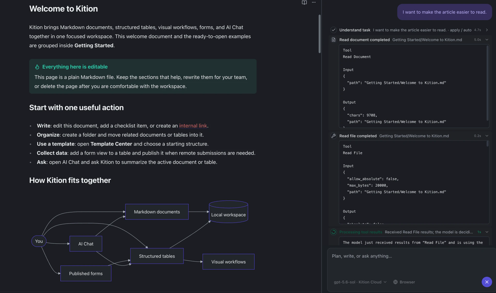
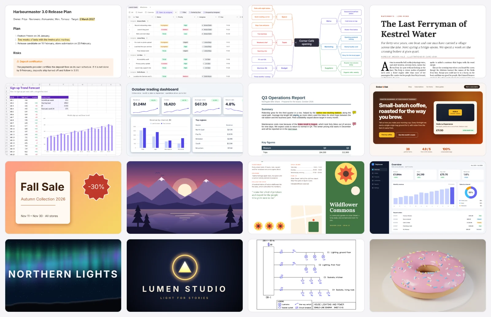

<h1 align="center">
   Kition
</h1>

  <a href="../../README.md">English</a> ·
  <a href="README.zh-CN.md">简体中文</a> ·
  <a href="README.ru-RU.md">Русский</a> ·
  <strong>日本語</strong> ·
  <a href="README.vi-VN.md">Tiếng Việt</a> ·
  <a href="README.fr-FR.md">Français</a> ·
  <a href="README.de-DE.md">Deutsch</a> ·
  <a href="README.es-ES.md">Español</a>

  <strong>Kition：AI のためのオープンなプロ向けスイート。</strong> 
  ノート、テーブル、ボード、プロ向けエディターを一つのデスクトップワークスペースにまとめ、あなたとエージェントが編集します。

  
  
  
  
  
  
  
  

<h3 align="center"><a href="https://github.com/KitionAI/kition/releases/latest"><ins>Kition をダウンロード</ins></a></h3>

  <a href="https://kition.ai">ウェブサイト</a> ·
  <a href="https://github.com/KitionAI/kition/releases/latest">ダウンロード</a> ·
  <a href="https://github.com/KitionAI/kition/discussions">ディスカッション</a> ·
  <a href="https://discord.gg/bFSjRDjVY">Discord</a> ·
  <a href="https://www.reddit.com/r/Kition">Reddit</a> ·
  <a href="https://x.com/KitionAI">X</a> ·
  <a href="../../.github/CONTRIBUTING.md">コントリビューション</a> ·
  <a href="../../.github/SUPPORT.md">サポート</a> ·
  <a href="../../.github/SECURITY.md">セキュリティ</a>

  

Kition は、Markdown ドキュメント、構造化テーブルファイル、無限に広がるボード、ツールを使う AI エージェント、ウェブ調査を一つのデスクトップワークスペースに統合します。すべてのタスクを空のチャットから始めるのではなく、Kition はエージェントが扱える編集可能なプロジェクトファイル、型付きレコード、添付ファイルを提供します。そのため、分断されたツール間でコンテキストを受け渡すことなく、AI の作業を確認・修正・再実行しやすくなります。

> Kition は現在ベータ版です。重要なワークスペースはバックアップし、本番のワークフローで利用する前にエージェントの変更を確認してください。

## Kition を選ぶ理由

- **つながるドキュメント。** ライブプレビュー、リンク、バックリンク、コールアウト、コード、数式、図、デイリーノート、エクスポートを備えた Markdown で書けます。
- **知識と並ぶ構造化データ。** 調査内容やコンテンツを、型付きレコード、数式、フィルター、グループ、ビュー、添付ファイル、AI フィールドに変換できます。
- **AI の変更をレビューできるビジュアル思考。** ボード上で図、マインドマップ、フロー、フリーハンドのスケッチを作成し、エージェントの変更は残す前に確認できます。
- **実際に操作できるエージェント。** ウェブを検索し、ドキュメントやテーブルスキーマを調べ、コンテンツを更新し、役立つ出力を現在のプロジェクトへ保存します。
- **レビュー可能なドキュメント編集。** エージェントに現在のドキュメントを編集させ、追加と削除をすべて確認し、変更ごとに承認または却下できます。
- **あらゆる種類のファイルに対応するキット。** 4 つの製品ラインにわたる 16 のキットが、スプレッドシート、スライド、写真、映像、CAD 図面などを通常のワークスペースファイルとして開き、エージェントは各キットのツールを通じてそれらを操作します。[キット](#キット)を参照してください。

## エージェントに編集を任せても、最終判断はあなたに

Kition エージェントは、コピー＆ペーストするための提案をまた一つ返すのではなく、現在の Markdown ドキュメントを読み、範囲を絞って変更し、結果をワークスペースへ書き戻せます。エージェントの作業中も、ドキュメントとタスクの実行過程全体が並んで表示されます。

  

エディターの外でファイルが変更されると、Kition は追加・削除・書き換えを強調したドキュメントのレビュー画面を開きます。変更は一つずつ承認または却下でき、編集全体を一つのまとまりとして確認することもできます。

  

これにより、制御されたドキュメントワークフローが実現します。自然言語で目的を伝え、エージェントに実際のファイルを編集させ、差分を確認し、最終ドキュメントに残す内容を正確に決めます。

## 空のプロンプトではなく、作業から始める

有能なエージェントは役に立ちますが、空のプロンプトでは、タスクの設計、すべての入力の説明、出力形式の選択、途中で失敗したときの立て直しを依然としてユーザーに求めます。Kition はその複雑さを、ドキュメント、テーブルフィールド、レコード、テンプレートといった使い慣れた作業画面に移します。

以下の組み込みシナリオは通常の `.ktable` ファイルです。プロンプト、フィールドの関係、生成された素材、レビュー状態は見える状態のまま残り、実際のプロジェクトに合わせて調整できます。

### キャンペーン素材を一括生成

主要メッセージと顔写真から始めます。型付きフィールドがコンテンツの種類と意図する感情を明示し、AI フィールドが各レコードに対して、関連付けられた 16:9 と 9:16 のサムネイル案を生成します。テーブルは一括処理のキューであり、同時にレビュー画面にもなります。

  

### レシート画像を検索可能なレコードへ変換

レシートの写真を添付フィールドにドロップします。画像認識を使うフィールドが、店舗名、住所、カテゴリ、構造化 JSON、OCR によるプレーンテキストを同じ行へ直接抽出します。その後、エージェントが結果をフィルター、修正、要約できます。

  

### 一つの商品概要から完全な素材パイプラインを展開

一つの商品コンセプトから、複数のデザイン案、正投影図、フィーチャー画像、ライフスタイル写真、スタイルボード、発売用コピーを生成できます。各結果は元のレコードに関連付けられたままなので、ばらばらのチャット出力を集めるよりも、全体の流れを比較、再生成、引き継ぎしやすくなります。

  

これらのシナリオは、Kition が想定する作業サイクルを示しています。文章による文脈にはドキュメント、構造化された状態にはテーブル、視覚的な思考にはボード、不確実な作業にはエージェントを使います。

## 製品ツアー

<table>
<tr>
<td width="42%" valign="middle">

### つながるドキュメントを書く

ライブプレビュー、内部リンク、バックリンク、タグ、アウトライン、埋め込み、コールアウト、コード、数式、図、テンプレート、デイリーノート、タブを備えた Markdown で書けます。完成した作業をワークスペースの外へ出す必要があるときは、PDF にエクスポートできます。

</td>
<td width="58%">
  
</td>
</tr>
<tr>
<td width="58%">
  
</td>
<td width="42%" valign="middle">

### データを役立つツールに変える

型付きフィールド、添付ファイル、数式、フィルター、並べ替え、グループ化、複数のビュー、すばやいレコード編集を備えた構造化テーブルファイルを作成できます。調査、コンテンツパイプライン、軽量な CRM、在庫管理、プロジェクト管理に活用できます。

</td>
</tr>
<tr>
<td width="42%" valign="middle">

### エージェントに実際のコンテキストを渡す

Kition エージェントに、ドキュメントの読み取りと更新、テーブルスキーマの確認、レコードの作成や変更、ウェブ検索、ツールの利用、計画に沿った作業を依頼できます。エージェントの出力は現在のワークスペースへ書き戻せます。

</td>
<td width="58%">
  
</td>
</tr>
<tr>
<td width="58%">
  
</td>
<td width="42%" valign="middle">

### 視覚的に考え、計画する

無限キャンバス上で、図、マインドマップ、フローチャート、付箋のまとまり、フリーハンドのスケッチを作成できます。ボードは Board キットが編集する `.kboard` ファイルで、エージェントはキットのツールを通じてボードを操作します。変更はその場で反映することも、ワークスペースに取り込む前にあなたが確認する下書きにすることもできます。

</td>
</tr>
</table>

## キット

キットは、一種類のファイルを扱うエディターです。キットのエンジンは WebAssembly にコンパイルされて Web Worker で動作し、キットは Kition の中に独自のエディターを描画します。エージェントはキットのツールを通じて同じファイルを編集するため、その変更は見える状態のまま確認できます。Kition のキットは 4 つの製品ラインに分かれており、Kition が同梱するパッケージは [`kits/kits.lock.json`](../../kits/kits.lock.json) で固定されています。

  

各画像は、キットが自身のコマンドで作成し、自身のエンジンでレンダリングしたファイルです。ほかの例は [Kition Showcase](https://github.com/KitionAI/kition-showcase) にあります。

| 製品ライン | キット | 編集対象 | 開く形式 | 作成する形式 |
| --- | --- | --- | --- | --- |
| オフィス | [Note](https://github.com/KitionAI/kition-note) | バイト単位でそのまま保存される Markdown ノート | `.md` `.markdown` | `.md` |
| オフィス | [Table](https://github.com/KitionAI/kition-table) | テーブル、ビュー、ダッシュボードを一つのファイルに | `.ktable` | `.ktable` |
| オフィス | [Board](https://github.com/KitionAI/kition-board) | 図、マインドマップ、スケッチのための無限のホワイトボード | `.kboard` | `.kboard` |
| オフィス | [Doc](https://github.com/KitionAI/kition-doc) | ワープロ文書（`.docx`） | `.docx` `.html` `.htm` | `.docx` |
| オフィス | [Sheet](https://github.com/KitionAI/kition-sheet) | 数式付きのスプレッドシート（`.xlsx`） | `.xlsx` `.xlsm` `.xltx` `.xltm` `.xls` `.xlt` `.et` `.ett` `.xlsb` `.ods` `.csv` | `.xlsx` |
| オフィス | [Slide](https://github.com/KitionAI/kition-slide) | スライド（`.pptx` ファイルを含む） | `.kslide` `.pptx` | `.kslide` |
| オフィス | [PDF](https://github.com/KitionAI/kition-pdf) | PDF ファイルの閲覧と編集 | `.pdf` | `.pdf` |
| オフィス | [HTML](https://github.com/KitionAI/kition-html)（プレビュー） | ライブプレビュー付きの HTML ページ | `.html` `.htm` | `.html` |
| デザイン | [Photo](https://github.com/KitionAI/kition-photo) | レイヤー画像（`.psd` ファイルを含む） | `.psd` `.psb` `.kphoto` | `.psd` |
| デザイン | [Vector](https://github.com/KitionAI/kition-vector) | ベクターグラフィックス | `.kvector` `.svg` `.ai` `.eps` | `.kvector` |
| デザイン | [Layout](https://github.com/KitionAI/kition-layout) | ページレイアウト：チラシ、ポスター、書籍 | `.klayout` `.idml` | `.klayout` |
| デザイン | [Design](https://github.com/KitionAI/kition-design)（プレビュー） | インターフェースと画面のデザイン | `.kdesign` `.fig` `.sketch` | `.kdesign` |
| メディア | [Film](https://github.com/KitionAI/kition-film) | 動画のタイムライン | `.kfilm` | `.kfilm` |
| メディア | [Motion](https://github.com/KitionAI/kition-motion) | キーフレームとエフェクトを使ったモーショングラフィックス | `.kmotion` | `.kmotion` |
| エンジニアリング | [CAD](https://github.com/KitionAI/kition-cad) | 2D CAD 図面（`.dxf`） | `.dxf` | `.dxf` |
| エンジニアリング | [Scene](https://github.com/KitionAI/kition-scene)（プレビュー） | 3D シーン | `.kscene` | `.kscene` |

「プレビュー」と記されたキットは初期段階のため、足りない部分があると考えてください。16 個すべてが Kition に同梱されています。

各キットはそれぞれ独自のリポジトリで開発されています。キットが Kition に組み込まれる仕組みについては、[キット](../kits.md)を参照してください。

そのほかの機能：

- レコードのコンテキストからテキスト、構造化された値、メディアを生成する AI 支援のテーブルフィールド。
- モデル、プロキシ、MCP、アカウント、使用量、更新、デスクトップ統合の設定。
- 実用的なドキュメントとテーブルの例を収めた、あらかじめ用意された Getting Started ワークスペース。

## インストール

デスクトップ版は [GitHub Releases](https://github.com/KitionAI/kition/releases/latest) で公開されています。

- **macOS（Apple シリコンまたは Intel）：** 最新の `.dmg` をダウンロードします。
- **Windows（x64）：** 最新の `-setup.exe` インストーラーをダウンロードします。
- **Linux（試験的）：** 最新の x86_64 `.AppImage` をダウンロードします。
- **旧バージョン：** すべての[リリース履歴](https://github.com/KitionAI/kition/releases)を参照してください。

## オープンソースの範囲

Kition デスクトップアプリを構成するものはすべて、このリポジトリでオープンソースとして公開されています。

- React レンダラー（`src/`）：ドキュメント、テーブル、エージェント、設定、シナリオ、キットホストの UI。
- Tauri デスクトップシェル（`src-tauri/`）とデスクトップ統合。
- Rust ランタイム（`crates/`）。シェルが同じプロセス内で実行し、HTTP API はループバックでのみ提供します。[ランタイム開発](../runtime-development.md)を参照してください。
- [`contracts/runtime/`](../../contracts/runtime/) のランタイム契約、モック、フィクスチャ、ブラックボックステスト。
- キットのバージョン固定（`kits/`）と、パッケージングおよびリリースのワークフロー。

キットは別のリポジトリで開発されています。Kition は各キットの公開済みパッケージを、[`kits/kits.lock.json`](../../kits/kits.lock.json) でバージョンとチェックサムを固定して同梱します。

## コントリビューション

Issue と Pull Request を歓迎します。ソースから Kition を実行する方法、リポジトリの構成、使用している技術については [CONTRIBUTING.md](../../.github/CONTRIBUTING.md) にまとめています。

1. 推奨される Orca の worktree ワークフローを含め、[Kition 開発標準](../development-standard.md)に従ってください。
2. レンダラーとランタイムにまたがる変更では、`contracts/runtime/` の契約、レンダラーのモック、ランタイムを同時に更新してください。
3. セキュリティに関わる問題は、公開 Issue ではなく [.github/SECURITY.md](../../.github/SECURITY.md) から報告してください。

製品に関する質問、アカウントのサポート、プライベートなワークスペースに関する相談については、[.github/SUPPORT.md](../../.github/SUPPORT.md) を参照してください。

## ライセンス

Kition（`crates/` 内のランタイムを含む）は Apache-2.0 の下でライセンスされています（[LICENSE](../../LICENSE)）。
