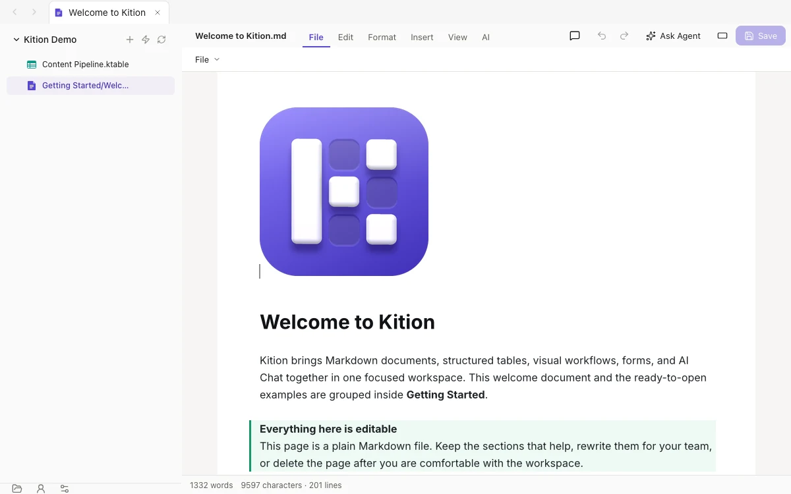

<h1 align="center">
   Kition
</h1>

  <a href="../../README.md">English</a> ·
  <a href="README.zh-CN.md">简体中文</a> ·
  <strong>Русский</strong> ·
  <a href="README.ja-JP.md">日本語</a> ·
  <a href="README.vi-VN.md">Tiếng Việt</a> ·
  <a href="README.fr-FR.md">Français</a> ·
  <a href="README.de-DE.md">Deutsch</a> ·
  <a href="README.es-ES.md">Español</a>

  <strong>Kition: открытый профессиональный пакет для AI.</strong> 
  Заметки, таблицы, доски и профессиональные редакторы в одном настольном рабочем пространстве, которое редактируете вы и ваш агент.

  
  
  
  
  
  
  
  

<h3 align="center"><a href="https://github.com/KitionAI/kition/releases/latest"><ins>Скачать Kition</ins></a></h3>

  <a href="https://kition.ai">Сайт</a> ·
  <a href="https://github.com/KitionAI/kition/releases/latest">Скачать</a> ·
  <a href="https://github.com/KitionAI/kition/discussions">Обсуждения</a> ·
  <a href="https://discord.gg/bFSjRDjVY">Discord</a> ·
  <a href="https://www.reddit.com/r/Kition">Reddit</a> ·
  <a href="https://x.com/KitionAI">X</a> ·
  <a href="../../.github/CONTRIBUTING.md">Участие</a> ·
  <a href="../../.github/SUPPORT.md">Поддержка</a> ·
  <a href="../../.github/SECURITY.md">Безопасность</a>

  

Kition объединяет в одном настольном рабочем пространстве Markdown-документы, файлы структурированных таблиц, бесконечные доски, AI-агента с инструментами и веб-исследования. Вместо того чтобы начинать каждую задачу с пустого чата, Kition даёт агенту для работы редактируемые файлы проекта, типизированные записи и вложения. Поэтому работу AI легче проверить, исправить и повторить, не перенося контекст между разрозненными инструментами.

> Kition сейчас находится на стадии бета-тестирования. Создавайте резервные копии важных рабочих пространств и проверяйте изменения агента, прежде чем полагаться на них в производственных процессах.

## Почему Kition

- **Связанные документы.** Пишите в Markdown с живым предпросмотром, ссылками, обратными ссылками, выносками, кодом, формулами, диаграммами, ежедневными заметками и экспортом.
- **Структурированные данные рядом со знаниями.** Превращайте исследования и контент в типизированные записи, формулы, фильтры, группы, представления, вложения и AI-поля.
- **Визуальное мышление с проверяемыми изменениями AI.** Стройте диаграммы, интеллект-карты, схемы процессов и свободные наброски на доске, а затем проверяйте изменения агента, прежде чем их сохранить.
- **Агент, который может действовать.** Ищет в интернете, изучает документы и схемы таблиц, обновляет содержимое и сохраняет полезные результаты в активный проект.
- **Проверяемые правки документов.** Позвольте агенту отредактировать активный документ, просмотрите каждое добавление и удаление, затем примите или отклоните отдельные изменения.
- **Наборы для любых типов файлов.** Шестнадцать наборов в четырёх продуктовых линейках открывают электронные таблицы, слайды, фотографии, видео, чертежи CAD и многое другое как обычные файлы рабочего пространства, а агент работает с ними через инструменты каждого набора. См. [Наборы](#наборы-kits).

## Агент редактирует — последнее слово остаётся за вами

Вместо очередного совета, который нужно копировать и вставлять, агент Kition может прочитать активный Markdown-документ, внести точечные изменения и записать результат обратно в рабочее пространство. Пока агент работает, документ и полный ход выполнения задачи видны одновременно.

  

Когда файл изменяется вне редактора, Kition открывает режим проверки документа, где выделены добавления, удаления и переписанные фрагменты. Каждое изменение можно принять или отклонить отдельно либо проверить всю правку целиком.

  

Так возникает управляемый процесс работы с документом: опишите цель на естественном языке, разрешите агенту изменить настоящий файл, проверьте различия и точно решите, что останется в итоговом документе.

## Начинайте с работы, а не с пустого запроса

Способный агент полезен, но пустой запрос по-прежнему требует от пользователя продумать задачу, описать все входные данные, выбрать формат результата и исправлять ситуацию, когда какой-то шаг идёт не так. Kition переносит эту сложность в привычную рабочую среду: документы, поля таблиц, записи и шаблоны.

Встроенные сценарии ниже — обычные файлы `.ktable`. Их запросы, связи между полями, сгенерированные материалы и статусы проверки остаются на виду, и их можно адаптировать под реальный проект.

### Пакетная генерация материалов кампании

Начните с ключевого сообщения и фотографии лица. Типизированные поля явно задают тип контента и нужную эмоцию, а AI-поля генерируют для каждой записи связанные варианты миниатюр 16:9 и 9:16. Таблица становится одновременно очередью пакетной обработки и местом проверки.

  

### Преобразование снимков чеков в записи, доступные для поиска

Перетащите фотографии чеков в поле вложений. Поля на основе компьютерного зрения извлекают продавца, адрес, категорию, структурированный JSON и простой OCR-текст прямо в ту же строку. Затем агент может отфильтровать, исправить или обобщить результаты.

  

### Полный конвейер материалов из одного описания продукта

Одна концепция продукта может дать несколько вариантов дизайна, ортографические виды, изображение с особенностями продукта, лайфстайл-снимок, стилевую доску и тексты для запуска. Каждый результат остаётся привязан к исходной записи, поэтому всю цепочку проще сравнить, сгенерировать заново и передать дальше, чем разрозненные ответы из чатов.

  

Эти сценарии показывают задуманный цикл работы в Kition: документы — для повествовательного контекста, таблицы — для структурированного состояния, доски — для визуального мышления, а агент — для задач с неопределённым результатом.

## Обзор продукта

<table>
<tr>
<td width="42%" valign="middle">

### Пишите связанные документы

Пишите в Markdown с живым предпросмотром, внутренними и обратными ссылками, тегами, структурой документа, встраиваниями, выносками, кодом, формулами, диаграммами, шаблонами, ежедневными заметками и вкладками. Экспортируйте готовую работу в PDF, когда её нужно вынести за пределы рабочего пространства.

</td>
<td width="58%">
  
</td>
</tr>
<tr>
<td width="58%">
  
</td>
<td width="42%" valign="middle">

### Превращайте данные в полезные инструменты

Создавайте файлы структурированных таблиц с типизированными полями, вложениями, формулами, фильтрами, сортировкой, группировкой, несколькими представлениями и быстрым редактированием записей. Используйте их для исследований, контент-конвейеров, простой CRM, учёта запасов или отслеживания проектов.

</td>
</tr>
<tr>
<td width="42%" valign="middle">

### Дайте агенту реальный контекст

Поручите агенту Kition читать и обновлять документы, изучать схемы таблиц, создавать или изменять записи, искать в интернете, использовать инструменты и следовать плану. Результаты агента можно записать обратно в активное рабочее пространство.

</td>
<td width="58%">
  
</td>
</tr>
<tr>
<td width="58%">
  
</td>
<td width="42%" valign="middle">

### Думайте и планируйте визуально

Создавайте диаграммы, интеллект-карты, блок-схемы, группы стикеров и свободные наброски на бесконечном холсте. Доски — это файлы `.kboard`, которые редактирует набор Board, а агент работает с ними через инструменты набора: вживую или в виде черновика, который вы проверяете, прежде чем он станет частью рабочего пространства.

</td>
</tr>
</table>

## Наборы (Kits)

Набор — это редактор для одного типа файлов. Его движок скомпилирован в WebAssembly и работает в Web Worker, а собственный редактор набор отрисовывает внутри Kition. Агент редактирует те же файлы через инструменты набора, поэтому его изменения остаются видимыми и доступными для проверки. Наборы Kition разделены на четыре продуктовые линейки; пакеты, которые поставляет Kition, закреплены в [`kits/kits.lock.json`](../../kits/kits.lock.json).

  

Каждое изображение — это файл, который набор создал собственными командами и отрисовал собственным движком; больше примеров — в [Kition Showcase](https://github.com/KitionAI/kition-showcase).

| Продуктовая линейка | Набор | Редактирует | Открывает | Создаёт |
| --- | --- | --- | --- | --- |
| Офис | [Note](https://github.com/KitionAI/kition-note) | Заметки Markdown, сохраняемые байт в байт | `.md` `.markdown` | `.md` |
| Офис | [Table](https://github.com/KitionAI/kition-table) | Таблицы, представления и дашборды в одном файле | `.ktable` | `.ktable` |
| Офис | [Board](https://github.com/KitionAI/kition-board) | Бесконечная доска для диаграмм, интеллект-карт и набросков | `.kboard` | `.kboard` |
| Офис | [Doc](https://github.com/KitionAI/kition-doc) | Текстовые документы (`.docx`) | `.docx` `.html` `.htm` | `.docx` |
| Офис | [Sheet](https://github.com/KitionAI/kition-sheet) | Электронные таблицы (`.xlsx`) с формулами | `.xlsx` `.xlsm` `.xltx` `.xltm` `.xls` `.xlt` `.et` `.ett` `.xlsb` `.ods` `.csv` | `.xlsx` |
| Офис | [Slide](https://github.com/KitionAI/kition-slide) | Слайды, включая файлы `.pptx` | `.kslide` `.pptx` | `.kslide` |
| Офис | [PDF](https://github.com/KitionAI/kition-pdf) | Чтение и редактирование PDF-файлов | `.pdf` | `.pdf` |
| Офис | [HTML](https://github.com/KitionAI/kition-html) (предварительная версия) | HTML-страницы с живым предпросмотром | `.html` `.htm` | `.html` |
| Дизайн | [Photo](https://github.com/KitionAI/kition-photo) | Многослойные изображения, включая файлы `.psd` | `.psd` `.psb` `.kphoto` | `.psd` |
| Дизайн | [Vector](https://github.com/KitionAI/kition-vector) | Векторная графика | `.kvector` `.svg` `.ai` `.eps` | `.kvector` |
| Дизайн | [Layout](https://github.com/KitionAI/kition-layout) | Макеты страниц: флаеры, плакаты и книги | `.klayout` `.idml` | `.klayout` |
| Дизайн | [Design](https://github.com/KitionAI/kition-design) (предварительная версия) | Дизайн интерфейсов и экранов | `.kdesign` `.fig` `.sketch` | `.kdesign` |
| Медиа | [Film](https://github.com/KitionAI/kition-film) | Таймлайны видеомонтажа | `.kfilm` | `.kfilm` |
| Медиа | [Motion](https://github.com/KitionAI/kition-motion) | Моушн-графика с ключевыми кадрами и эффектами | `.kmotion` | `.kmotion` |
| Инженерия | [CAD](https://github.com/KitionAI/kition-cad) | 2D-чертежи CAD (`.dxf`) | `.dxf` | `.dxf` |
| Инженерия | [Scene](https://github.com/KitionAI/kition-scene) (предварительная версия) | 3D-сцены | `.kscene` | `.kscene` |

Наборы с пометкой «предварительная версия» находятся на ранней стадии: в них возможны пробелы. Все шестнадцать поставляются вместе с Kition.

Каждый набор разрабатывается в собственном репозитории; о том, как наборы подключаются к Kition, см. [Наборы](../kits.md).

Также включено:

- AI-поля таблиц для генерации текста, структурированных значений и медиа на основе контекста записи.
- Настройки моделей, прокси, MCP, учётной записи, использования, обновлений и интеграции с системой.
- Готовое рабочее пространство «Начало работы» с практическими примерами документов и таблиц.

## Установка

Настольные сборки публикуются в [GitHub Releases](https://github.com/KitionAI/kition/releases/latest).

- **macOS (Apple silicon или Intel):** скачайте последний `.dmg`.
- **Windows (x64):** скачайте последний установщик `-setup.exe`.
- **Linux (экспериментально):** скачайте последний `.AppImage` для x86_64.
- **Предыдущие версии:** смотрите полную [историю выпусков](https://github.com/KitionAI/kition/releases).

## Граница открытого исходного кода

Всё, из чего состоит настольное приложение Kition, открыто в этом репозитории:

- рендерер React (`src/`): интерфейс документов, таблиц, агента, настроек, сценариев и хоста наборов;
- настольная оболочка Tauri (`src-tauri/`) и интеграция с системой;
- среда выполнения на Rust (`crates/`), которую оболочка запускает в том же процессе и которая предоставляет свой HTTP API только на loopback-интерфейсе. См. [Разработка среды выполнения](../runtime-development.md);
- контракты среды выполнения в [`contracts/runtime/`](../../contracts/runtime/), моки, фикстуры и тесты методом чёрного ящика;
- закреплённые версии наборов (`kits/`), а также процессы упаковки и выпуска.

Наборы разрабатываются в отдельных репозиториях. Kition поставляет опубликованный пакет каждого набора, закреплённый по версии и контрольной сумме в [`kits/kits.lock.json`](../../kits/kits.lock.json).

## Участие в разработке

Мы приветствуем issue и pull request. Как запустить Kition из исходного кода, как устроен репозиторий и какие технологии в нём используются, описано в [CONTRIBUTING.md](../../.github/CONTRIBUTING.md).

1. Следуйте [стандарту разработки Kition](../development-standard.md), включая рекомендуемый процесс работы с worktree в Orca.
2. Если изменение затрагивает и рендерер, и среду выполнения, обновляйте вместе контракт в `contracts/runtime/`, мок рендерера и саму среду выполнения.
3. Сообщайте о проблемах, связанных с безопасностью, через [.github/SECURITY.md](../../.github/SECURITY.md), а не в публичном issue.

По вопросам о продукте, помощи с учётной записью и конфиденциальным вопросам о рабочих пространствах см. [.github/SUPPORT.md](../../.github/SUPPORT.md).

## Лицензия

Kition, включая среду выполнения в `crates/`, распространяется по лицензии Apache-2.0 ([LICENSE](../../LICENSE)).
