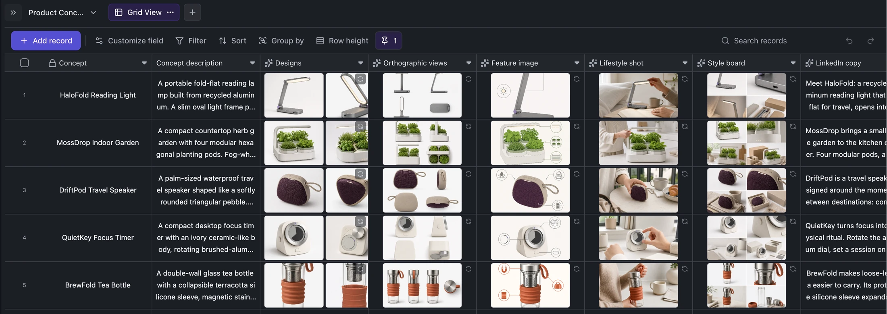

<h1 align="center">
   Kition
</h1>

  <a href="../../README.md">English</a> ·
  <a href="README.zh-CN.md">简体中文</a> ·
  <a href="README.ru-RU.md">Русский</a> ·
  <a href="README.ja-JP.md">日本語</a> ·
  <strong>Tiếng Việt</strong> ·
  <a href="README.fr-FR.md">Français</a> ·
  <a href="README.de-DE.md">Deutsch</a> ·
  <a href="README.es-ES.md">Español</a>

  <strong>Kition: bộ công cụ chuyên nghiệp mở cho AI.</strong> 
  Ghi chú, bảng dữ liệu, bảng trắng và các trình chỉnh sửa chuyên nghiệp trong một không gian làm việc trên máy tính, do bạn và tác nhân của bạn cùng chỉnh sửa.

  
  
  
  
  
  
  
  

<h3 align="center"><a href="https://github.com/KitionAI/kition/releases/latest"><ins>Tải Kition</ins></a></h3>

  <a href="https://kition.ai">Trang web</a> ·
  <a href="https://github.com/KitionAI/kition/releases/latest">Tải xuống</a> ·
  <a href="https://github.com/KitionAI/kition/discussions">Thảo luận</a> ·
  <a href="https://discord.gg/bFSjRDjVY">Discord</a> ·
  <a href="https://www.reddit.com/r/Kition">Reddit</a> ·
  <a href="https://x.com/KitionAI">X</a> ·
  <a href="../../.github/CONTRIBUTING.md">Đóng góp</a> ·
  <a href="../../.github/SUPPORT.md">Hỗ trợ</a> ·
  <a href="../../.github/SECURITY.md">Bảo mật</a>

  

Kition kết hợp tài liệu Markdown, tệp bảng có cấu trúc, các Board vô hạn, một tác nhân AI biết dùng công cụ và nghiên cứu web trong một không gian làm việc trên máy tính. Thay vì để mọi tác vụ bắt đầu từ một cuộc trò chuyện trống, Kition cung cấp cho tác nhân các tệp dự án có thể chỉnh sửa, bản ghi có kiểu và tệp đính kèm để làm việc. Nhờ đó, công việc của AI dễ kiểm tra, sửa và lặp lại hơn, mà không phải chuyển ngữ cảnh qua lại giữa các công cụ rời rạc.

> Kition hiện đang ở giai đoạn beta. Hãy sao lưu các không gian làm việc quan trọng và xem lại thay đổi của tác nhân trước khi dựa vào chúng trong quy trình sản xuất.

## Vì sao chọn Kition

- **Tài liệu liên kết.** Viết Markdown với xem trước trực tiếp, liên kết, backlink, callout, mã, công thức toán, sơ đồ, ghi chú hằng ngày và xuất tệp.
- **Dữ liệu có cấu trúc bên cạnh tri thức.** Biến kết quả nghiên cứu và nội dung thành bản ghi có kiểu, công thức, bộ lọc, nhóm, chế độ xem, tệp đính kèm và trường AI.
- **Tư duy trực quan với thay đổi AI có thể xem xét.** Tạo sơ đồ, sơ đồ tư duy, lưu đồ và bản phác thảo tự do trên Board, rồi xem lại thay đổi của tác nhân trước khi giữ chúng.
- **Tác nhân có thể hành động.** Tìm kiếm trên web, kiểm tra tài liệu và lược đồ bảng, cập nhật nội dung và lưu kết quả hữu ích vào dự án đang mở.
- **Chỉnh sửa tài liệu có thể xem xét.** Cho phép tác nhân sửa tài liệu đang mở, kiểm tra từng phần thêm hoặc xóa, rồi chấp nhận hay từ chối từng thay đổi.
- **Kit cho mọi loại tệp.** Mười sáu kit thuộc bốn dòng sản phẩm mở bảng tính, bản trình chiếu, ảnh, phim, bản vẽ CAD và nhiều loại khác như các tệp thông thường trong không gian làm việc, và tác nhân làm việc với chúng qua công cụ của từng kit. Xem [Kit](#kit).

## Để tác nhân chỉnh sửa — bạn vẫn là người quyết định

Thay vì trả về thêm một gợi ý để sao chép và dán, tác nhân Kition có thể đọc tài liệu Markdown đang mở, thực hiện các thay đổi đúng phạm vi và ghi kết quả trở lại không gian làm việc. Tài liệu và toàn bộ dấu vết tác vụ cùng hiển thị trong khi tác nhân làm việc.

  

Khi tệp được thay đổi bên ngoài trình chỉnh sửa, Kition mở giao diện xem xét tài liệu, làm nổi bật nội dung thêm, xóa và viết lại. Bạn có thể chấp nhận hoặc từ chối từng thay đổi riêng lẻ, hoặc xem xét toàn bộ lần chỉnh sửa như một tập duy nhất.

  

Điều này tạo ra một quy trình tài liệu có kiểm soát: mô tả mục tiêu bằng ngôn ngữ tự nhiên, để tác nhân sửa tệp thật, kiểm tra phần khác biệt và quyết định chính xác nội dung nào được giữ trong tài liệu cuối cùng.

## Bắt đầu từ công việc, không phải lời nhắc trống

Một tác nhân có năng lực rất hữu ích, nhưng lời nhắc trống vẫn bắt người dùng tự thiết kế tác vụ, mô tả mọi đầu vào, chọn định dạng đầu ra và tự khắc phục khi một bước gặp sự cố. Kition chuyển sự phức tạp đó vào các giao diện làm việc quen thuộc: tài liệu, trường bảng, bản ghi và mẫu.

Các kịch bản tích hợp dưới đây là các tệp `.ktable` thông thường. Lời nhắc, quan hệ giữa các trường, nội dung đã tạo và trạng thái xem xét của chúng luôn hiển thị và có thể được điều chỉnh cho một dự án thực tế.

### Tạo hàng loạt nội dung chiến dịch

Bắt đầu với một thông điệp chính và một ảnh chân dung. Các trường có kiểu giữ cho loại nội dung và cảm xúc mong muốn luôn rõ ràng, trong khi các trường AI tạo các biến thể hình thu nhỏ 16:9 và 9:16 được liên kết cho từng bản ghi. Bảng vừa là hàng đợi xử lý hàng loạt, vừa là giao diện xem xét.

  

### Chuyển ảnh hóa đơn thành bản ghi có thể tìm kiếm

Thả ảnh hóa đơn vào một trường đính kèm. Các trường dùng thị giác máy tính trích xuất nhà cung cấp, địa chỉ, danh mục, JSON có cấu trúc và văn bản OCR thuần ngay vào cùng một hàng. Sau đó, tác nhân có thể lọc, sửa hoặc tóm tắt kết quả.

  

### Mở rộng một bản mô tả sản phẩm thành chuỗi nội dung hoàn chỉnh

Một ý tưởng sản phẩm có thể tạo ra nhiều phương án thiết kế, hình chiếu vuông góc, một ảnh tính năng, một ảnh phong cách sống, một bảng phong cách và nội dung ra mắt. Mỗi kết quả vẫn gắn với bản ghi nguồn, nên toàn bộ chuỗi dễ so sánh, tạo lại và bàn giao hơn so với một tập hợp các câu trả lời trò chuyện rời rạc.

  

Các kịch bản này cho thấy vòng làm việc mà Kition hướng tới: dùng tài liệu cho ngữ cảnh dạng văn bản, bảng cho trạng thái có cấu trúc, Board cho tư duy trực quan và tác nhân cho những công việc chưa xác định rõ.

## Tham quan sản phẩm

<table>
<tr>
<td width="42%" valign="middle">

### Viết tài liệu liên kết

Viết Markdown với xem trước trực tiếp, liên kết nội bộ, backlink, thẻ, dàn ý, nội dung nhúng, callout, mã, công thức toán, sơ đồ, mẫu, ghi chú hằng ngày và tab. Xuất tài liệu đã hoàn thành sang PDF khi cần đưa nó ra khỏi không gian làm việc.

</td>
<td width="58%">
  
</td>
</tr>
<tr>
<td width="58%">
  
</td>
<td width="42%" valign="middle">

### Biến dữ liệu thành công cụ hữu ích

Tạo tệp bảng có cấu trúc với trường có kiểu, tệp đính kèm, công thức, bộ lọc, sắp xếp, nhóm, nhiều chế độ xem và chỉnh sửa bản ghi nhanh. Dùng chúng cho nghiên cứu, quy trình sản xuất nội dung, CRM gọn nhẹ, quản lý kho hoặc theo dõi dự án.

</td>
</tr>
<tr>
<td width="42%" valign="middle">

### Cung cấp ngữ cảnh thực cho tác nhân

Yêu cầu tác nhân Kition đọc và cập nhật tài liệu, kiểm tra lược đồ bảng, tạo hoặc sửa bản ghi, tìm kiếm trên web, dùng công cụ và làm theo kế hoạch. Kết quả của tác nhân có thể được ghi trở lại không gian làm việc đang mở.

</td>
<td width="58%">
  
</td>
</tr>
<tr>
<td width="58%">
  
</td>
<td width="42%" valign="middle">

### Tư duy và lập kế hoạch trực quan

Tạo sơ đồ, sơ đồ tư duy, lưu đồ, cụm ghi chú dán và bản phác thảo tự do trên một khung vẽ vô hạn. Board là các tệp `.kboard` do kit Board chỉnh sửa, và tác nhân làm việc với chúng qua công cụ của kit, theo thời gian thực hoặc dưới dạng bản nháp để bạn xem xét trước khi nó trở thành một phần của không gian làm việc.

</td>
</tr>
</table>

## Kit

Kit là trình chỉnh sửa cho một loại tệp. Engine của kit được biên dịch sang WebAssembly và chạy trong một Web Worker, còn kit tự vẽ trình chỉnh sửa của riêng nó bên trong Kition. Tác nhân chỉnh sửa cùng các tệp đó qua công cụ của kit, nên các thay đổi của nó luôn hiển thị và có thể xem xét. Các kit của Kition thuộc bốn dòng sản phẩm; các gói đi kèm Kition được cố định trong [`kits/kits.lock.json`](../../kits/kits.lock.json).

  

Mỗi hình là một tệp do một kit tạo bằng chính các lệnh của nó và kết xuất bằng chính engine của nó; nhiều tệp khác có trong [Kition Showcase](https://github.com/KitionAI/kition-showcase).

| Dòng sản phẩm | Kit | Chỉnh sửa | Mở | Tạo |
| --- | --- | --- | --- | --- |
| Văn phòng | [Note](https://github.com/KitionAI/kition-note) | Ghi chú Markdown, lưu chính xác từng byte | `.md` `.markdown` | `.md` |
| Văn phòng | [Table](https://github.com/KitionAI/kition-table) | Bảng, chế độ xem và bảng điều khiển trong một tệp | `.ktable` | `.ktable` |
| Văn phòng | [Board](https://github.com/KitionAI/kition-board) | Bảng trắng vô hạn cho sơ đồ, sơ đồ tư duy và bản phác thảo | `.kboard` | `.kboard` |
| Văn phòng | [Doc](https://github.com/KitionAI/kition-doc) | Tài liệu văn bản (`.docx`) | `.docx` `.html` `.htm` | `.docx` |
| Văn phòng | [Sheet](https://github.com/KitionAI/kition-sheet) | Bảng tính (`.xlsx`) có công thức | `.xlsx` `.xlsm` `.xltx` `.xltm` `.xls` `.xlt` `.et` `.ett` `.xlsb` `.ods` `.csv` | `.xlsx` |
| Văn phòng | [Slide](https://github.com/KitionAI/kition-slide) | Trang trình chiếu, bao gồm tệp `.pptx` | `.kslide` `.pptx` | `.kslide` |
| Văn phòng | [PDF](https://github.com/KitionAI/kition-pdf) | Đọc và chỉnh sửa tệp PDF | `.pdf` | `.pdf` |
| Văn phòng | [HTML](https://github.com/KitionAI/kition-html) (Bản xem trước) | Trang HTML, có xem trước trực tiếp | `.html` `.htm` | `.html` |
| Thiết kế | [Photo](https://github.com/KitionAI/kition-photo) | Ảnh nhiều lớp, bao gồm tệp `.psd` | `.psd` `.psb` `.kphoto` | `.psd` |
| Thiết kế | [Vector](https://github.com/KitionAI/kition-vector) | Đồ họa vector | `.kvector` `.svg` `.ai` `.eps` | `.kvector` |
| Thiết kế | [Layout](https://github.com/KitionAI/kition-layout) | Dàn trang: tờ rơi, áp phích và sách | `.klayout` `.idml` | `.klayout` |
| Thiết kế | [Design](https://github.com/KitionAI/kition-design) (Bản xem trước) | Thiết kế giao diện và màn hình | `.kdesign` `.fig` `.sketch` | `.kdesign` |
| Đa phương tiện | [Film](https://github.com/KitionAI/kition-film) | Dòng thời gian video | `.kfilm` | `.kfilm` |
| Đa phương tiện | [Motion](https://github.com/KitionAI/kition-motion) | Đồ họa chuyển động với khung hình chính và hiệu ứng | `.kmotion` | `.kmotion` |
| Kỹ thuật | [CAD](https://github.com/KitionAI/kition-cad) | Bản vẽ CAD 2D (`.dxf`) | `.dxf` | `.dxf` |
| Kỹ thuật | [Scene](https://github.com/KitionAI/kition-scene) (Bản xem trước) | Cảnh 3D | `.kscene` | `.kscene` |

Các kit được đánh dấu Bản xem trước còn ở giai đoạn đầu: có thể còn thiếu sót. Cả mười sáu kit đều đi kèm Kition.

Mỗi kit được phát triển trong kho riêng; xem [Kit](../kits.md) để biết cách các kit tích hợp vào Kition.

Ngoài ra còn có:

- Các trường bảng có AI hỗ trợ để tạo văn bản, giá trị có cấu trúc và nội dung đa phương tiện từ ngữ cảnh của bản ghi.
- Cài đặt mô hình, proxy, MCP, tài khoản, mức sử dụng, cập nhật và tích hợp máy tính.
- Một không gian làm việc hướng dẫn bắt đầu được tạo sẵn, với các ví dụ thực tế về tài liệu và bảng.

## Cài đặt

Bản dựng cho máy tính được phát hành qua [GitHub Releases](https://github.com/KitionAI/kition/releases/latest).

- **macOS (Apple silicon hoặc Intel):** tải tệp `.dmg` mới nhất.
- **Windows (x64):** tải trình cài đặt `-setup.exe` mới nhất.
- **Linux (thử nghiệm):** tải tệp `.AppImage` x86_64 mới nhất.
- **Phiên bản trước:** xem toàn bộ [lịch sử phát hành](https://github.com/KitionAI/kition/releases).

## Phạm vi mã nguồn mở

Mọi thành phần tạo nên ứng dụng máy tính Kition đều là mã nguồn mở trong kho này:

- trình kết xuất React (`src/`): giao diện cho tài liệu, bảng, tác nhân, cài đặt, kịch bản và phần chứa kit;
- vỏ ứng dụng máy tính Tauri (`src-tauri/`) và phần tích hợp máy tính;
- runtime Rust (`crates/`), được vỏ ứng dụng chạy trong cùng tiến trình và chỉ phục vụ API HTTP của nó trên loopback. Xem [Phát triển runtime](../runtime-development.md);
- hợp đồng runtime trong [`contracts/runtime/`](../../contracts/runtime/), mock, fixture và kiểm thử hộp đen;
- phần cố định phiên bản kit (`kits/`) cùng quy trình đóng gói và phát hành.

Các kit được phát triển trong các kho riêng. Kition đi kèm gói đã phát hành của từng kit, được cố định theo phiên bản và mã kiểm tra trong [`kits/kits.lock.json`](../../kits/kits.lock.json).

## Đóng góp

Chúng tôi hoan nghênh issue và pull request. Cách chạy Kition từ mã nguồn, cấu trúc kho và công nghệ được sử dụng có trong [CONTRIBUTING.md](../../.github/CONTRIBUTING.md).

1. Tuân theo [Tiêu chuẩn phát triển Kition](../development-standard.md), bao gồm quy trình worktree Orca được khuyến nghị.
2. Khi một thay đổi liên quan cả trình kết xuất và runtime, hãy cập nhật đồng thời hợp đồng trong `contracts/runtime/`, mock của trình kết xuất và runtime.
3. Báo cáo các vấn đề nhạy cảm về bảo mật qua [.github/SECURITY.md](../../.github/SECURITY.md), không qua issue công khai.

Với câu hỏi về sản phẩm, trợ giúp tài khoản và các vấn đề riêng tư về không gian làm việc, xem [.github/SUPPORT.md](../../.github/SUPPORT.md).

## Giấy phép

Kition, bao gồm runtime trong `crates/`, được cấp phép theo Apache-2.0 ([LICENSE](../../LICENSE)).
