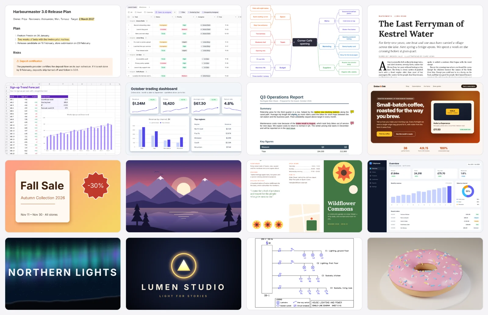

<h1 align="center">
   Kition
</h1>

  <a href="../../README.md">English</a> ·
  <strong>简体中文</strong> ·
  <a href="README.ru-RU.md">Русский</a> ·
  <a href="README.ja-JP.md">日本語</a> ·
  <a href="README.vi-VN.md">Tiếng Việt</a> ·
  <a href="README.fr-FR.md">Français</a> ·
  <a href="README.de-DE.md">Deutsch</a> ·
  <a href="README.es-ES.md">Español</a>

  <strong>Kition：面向 AI 的开放专业软件套装。</strong> 
  笔记、表格、白板和专业编辑器汇聚在同一个桌面工作区中，由你和你的智能体共同编辑。

  
  
  
  
  
  
  
  

<h3 align="center"><a href="https://github.com/KitionAI/kition/releases/latest"><ins>下载 Kition</ins></a></h3>

  <a href="https://kition.ai">网站</a> ·
  <a href="https://github.com/KitionAI/kition/releases/latest">下载</a> ·
  <a href="https://github.com/KitionAI/kition/discussions">讨论区</a> ·
  <a href="https://discord.gg/bFSjRDjVY">Discord</a> ·
  <a href="https://www.reddit.com/r/Kition">Reddit</a> ·
  <a href="https://x.com/KitionAI">X</a> ·
  <a href="../../.github/CONTRIBUTING.md">参与贡献</a> ·
  <a href="../../.github/SUPPORT.md">支持</a> ·
  <a href="../../.github/SECURITY.md">安全</a>

  

Kition 将 Markdown 文档、结构化表格文件、无限白板、可调用工具的 AI 智能体和网络研究整合到同一个桌面工作区中。Kition 不让每项任务都从空白对话开始，而是为智能体提供可编辑的项目文件、类型化记录和附件。这样，AI 的工作更容易检查、修正和重复，也无需在互不相通的工具之间来回传递上下文。

> Kition 目前处于测试阶段。请备份重要的工作区，并在生产工作流中依赖智能体所做的更改之前先审查这些更改。

## 为什么选择 Kition

- **相互连接的文档。** 用 Markdown 写作，支持实时预览、链接、反向链接、标注、代码、数学公式、图表、每日笔记和导出。
- **知识旁边的结构化数据。** 将研究和内容整理为类型化记录、公式、筛选、分组、视图、附件和 AI 字段。
- **可视化思考，AI 更改可审查。** 在白板上绘制图表、思维导图、流程图和自由草图，并在保留之前审查智能体所做的更改。
- **能够执行操作的智能体。** 搜索网页，检查文档和表结构，更新内容，并将有用的输出保存到当前项目中。
- **可审查的文档编辑。** 让智能体编辑当前文档，查看每一处新增和删除，再逐项接受或拒绝更改。
- **适用于各类文件的套件。** 四条产品线中的十六个套件将电子表格、幻灯片、照片、影片、CAD 图纸等作为普通工作区文件打开，智能体则通过每个套件的工具处理这些文件。参见[套件](#套件)。

## 让智能体编辑，最终决定权由你掌握

Kition 智能体不只是再给出一条需要复制粘贴的建议。它可以读取当前的 Markdown 文档，在限定范围内进行修改，并将结果写回工作区。智能体工作时，文档和完整的任务执行过程会同时显示。

  

当文件在编辑器之外发生变化时，Kition 会打开文档审阅界面，突出显示新增、删除和改写的内容。每处更改都可以单独接受或拒绝，也可以将整次编辑作为一组整体审阅。

  

这样就形成了一个可控的文档工作流：用自然语言描述目标，让智能体编辑真实文件，检查差异，并准确决定最终文档中保留哪些内容。

## 从工作开始，而不是从空白提示词开始

能力强的智能体固然有用，但面对空白提示词，用户仍需自己设计任务、描述每项输入、选择输出格式，并在某一步出错时自行补救。Kition 将这些复杂性转移到熟悉的工作界面中：文档、表格字段、记录和模板。

下面的内置场景都是普通的 `.ktable` 文件。它们的提示词、字段关系、生成的素材和审阅状态都保持可见，并可改造用于真实项目。

### 批量生成活动素材

从一条核心信息和一张人脸照片开始。类型化字段明确记录内容类型和预期情绪，AI 字段则为每条记录生成相互关联的 16:9 和 9:16 缩略图版本。表格既是批处理队列，也是审阅界面。

  

### 将票据图片转换为可搜索的记录

将票据照片拖入附件字段。基于视觉能力的字段会将商户、地址、类别、结构化 JSON 和 OCR 纯文本直接提取到同一行中。之后，智能体可以对结果进行筛选、修正或汇总。

  

### 从一份产品简介扩展出完整的素材流程

一个产品概念可以衍生出多个候选设计、正交视图、功能图、生活场景图、风格板和发布文案。每个结果都附属于源记录，因此与一堆互不关联的聊天输出相比，整条链路更容易比较、重新生成和交接。

  

这些场景展示了 Kition 预期的工作循环：用文档承载叙述性上下文，用表格管理结构化状态，用白板进行可视化思考，用智能体处理不确定的工作。

## 产品导览

<table>
<tr>
<td width="42%" valign="middle">

### 编写相互连接的文档

用 Markdown 写作，支持实时预览、内部链接、反向链接、标签、大纲、嵌入、标注、代码、数学公式、图表、模板、每日笔记和标签页。需要在工作区之外使用时，可将完成的内容导出为 PDF。

</td>
<td width="58%">
  
</td>
</tr>
<tr>
<td width="58%">
  
</td>
<td width="42%" valign="middle">

### 将数据变成实用工具

创建结构化表格文件，支持类型化字段、附件、公式、筛选、排序、分组、多视图和快速记录编辑。可用于研究、内容流水线、轻量级 CRM、库存管理或项目跟踪。

</td>
</tr>
<tr>
<td width="42%" valign="middle">

### 为智能体提供真实上下文

让 Kition 智能体读取和更新文档、检查表结构、创建或修改记录、搜索网页、使用工具并按计划执行。智能体的输出可以写回当前工作区。

</td>
<td width="58%">
  
</td>
</tr>
<tr>
<td width="58%">
  
</td>
<td width="42%" valign="middle">

### 可视化思考与规划

在无限画布上绘制图表、思维导图、流程图、便签分组和自由草图。白板是由 Board 套件编辑的 `.kboard` 文件，智能体通过该套件的工具处理白板：既可以实时修改，也可以先生成草稿，经你审阅后再纳入工作区。

</td>
</tr>
</table>

## 套件

套件（Kit）是针对某一类文件的编辑器。它的引擎编译为 WebAssembly，在 Web Worker 中运行，套件在 Kition 内绘制自己的编辑器。智能体通过套件的工具编辑同一批文件，因此它的更改始终可见、可审查。Kition 的套件分为四条产品线；Kition 随附的包版本固定在 [`kits/kits.lock.json`](../../kits/kits.lock.json) 中。

  

每张图片都是一个文件，由对应套件用自己的命令构建，并用自己的引擎渲染；更多示例见 [Kition Showcase](https://github.com/KitionAI/kition-showcase)。

| 产品线 | 套件 | 编辑内容 | 可打开 | 可创建 |
| --- | --- | --- | --- | --- |
| 办公 | [Note](https://github.com/KitionAI/kition-note) | Markdown 笔记，逐字节原样保存 | `.md` `.markdown` | `.md` |
| 办公 | [Table](https://github.com/KitionAI/kition-table) | 表格、视图和仪表盘，集中在一个文件中 | `.ktable` | `.ktable` |
| 办公 | [Board](https://github.com/KitionAI/kition-board) | 用于图表、思维导图和草图的无限白板 | `.kboard` | `.kboard` |
| 办公 | [Doc](https://github.com/KitionAI/kition-doc) | 文字处理文档（`.docx`） | `.docx` `.html` `.htm` | `.docx` |
| 办公 | [Sheet](https://github.com/KitionAI/kition-sheet) | 带公式的电子表格（`.xlsx`） | `.xlsx` `.xlsm` `.xltx` `.xltm` `.xls` `.xlt` `.et` `.ett` `.xlsb` `.ods` `.csv` | `.xlsx` |
| 办公 | [Slide](https://github.com/KitionAI/kition-slide) | 幻灯片，包括 `.pptx` 文件 | `.kslide` `.pptx` | `.kslide` |
| 办公 | [PDF](https://github.com/KitionAI/kition-pdf) | 阅读和编辑 PDF 文件 | `.pdf` | `.pdf` |
| 办公 | [HTML](https://github.com/KitionAI/kition-html)（预览版） | HTML 页面，支持实时预览 | `.html` `.htm` | `.html` |
| 设计 | [Photo](https://github.com/KitionAI/kition-photo) | 分层图像，包括 `.psd` 文件 | `.psd` `.psb` `.kphoto` | `.psd` |
| 设计 | [Vector](https://github.com/KitionAI/kition-vector) | 矢量图形 | `.kvector` `.svg` `.ai` `.eps` | `.kvector` |
| 设计 | [Layout](https://github.com/KitionAI/kition-layout) | 页面排版：传单、海报和书籍 | `.klayout` `.idml` | `.klayout` |
| 设计 | [Design](https://github.com/KitionAI/kition-design)（预览版） | 界面与屏幕设计 | `.kdesign` `.fig` `.sketch` | `.kdesign` |
| 媒体 | [Film](https://github.com/KitionAI/kition-film) | 视频时间线 | `.kfilm` | `.kfilm` |
| 媒体 | [Motion](https://github.com/KitionAI/kition-motion) | 带关键帧和特效的动态图形 | `.kmotion` | `.kmotion` |
| 工程 | [CAD](https://github.com/KitionAI/kition-cad) | 2D CAD 图纸（`.dxf`） | `.dxf` | `.dxf` |
| 工程 | [Scene](https://github.com/KitionAI/kition-scene)（预览版） | 3D 场景 | `.kscene` | `.kscene` |

标记为“预览版”的套件仍处于早期阶段，可能存在不足。全部十六个套件都随 Kition 一起提供。

每个套件都在各自的仓库中开发；套件如何接入 Kition，请参阅[套件](../kits.md)。

此外还包括：

- AI 辅助的表格字段，可根据记录上下文生成文本、结构化值和媒体。
- 模型、代理、MCP、账户、用量、更新与桌面集成设置。
- 预置的入门（Getting Started）工作区，包含实用的文档和表格示例。

## 安装

桌面版本通过 [GitHub Releases](https://github.com/KitionAI/kition/releases/latest) 发布。

- **macOS（Apple 芯片或 Intel）：** 下载最新的 `.dmg`。
- **Windows（x64）：** 下载最新的 `-setup.exe` 安装程序。
- **Linux（实验性）：** 下载最新的 x86_64 `.AppImage`。
- **历史版本：** 浏览完整的[发布记录](https://github.com/KitionAI/kition/releases)。

## 开源边界

构成 Kition 桌面应用的所有部分都在本仓库中开源：

- React 渲染器（`src/`）：文档、表格、智能体、设置、场景和套件宿主界面；
- Tauri 桌面外壳（`src-tauri/`）及桌面集成；
- Rust 运行时（`crates/`），由外壳在同一进程内运行，其 HTTP API 仅在回环地址上提供服务。参见[运行时开发](../runtime-development.md)；
- [`contracts/runtime/`](../../contracts/runtime/) 中的运行时契约、模拟数据、测试夹具和黑盒测试；
- 套件版本锁定（`kits/`）以及打包和发布工作流。

套件在独立的仓库中开发。Kition 随附每个套件已发布的包，并在 [`kits/kits.lock.json`](../../kits/kits.lock.json) 中按版本和校验和固定。

## 参与贡献

欢迎提交 Issue 和 Pull Request。如何从源码运行 Kition、仓库结构以及所用技术，请参阅 [CONTRIBUTING.md](../../.github/CONTRIBUTING.md)。

1. 遵循 [Kition 开发标准](../development-standard.md)，包括推荐的 Orca worktree 工作流。
2. 当更改同时涉及渲染器和运行时时，请一并更新 `contracts/runtime/` 中的契约、渲染器模拟和运行时。
3. 安全敏感问题请通过 [.github/SECURITY.md](../../.github/SECURITY.md) 报告，不要提交公开 Issue。

产品问题、账户帮助和私有工作区相关事宜，请参阅 [.github/SUPPORT.md](../../.github/SUPPORT.md)。

## 许可证

Kition（包括 `crates/` 中的运行时）采用 Apache-2.0 许可证（[LICENSE](../../LICENSE)）。
